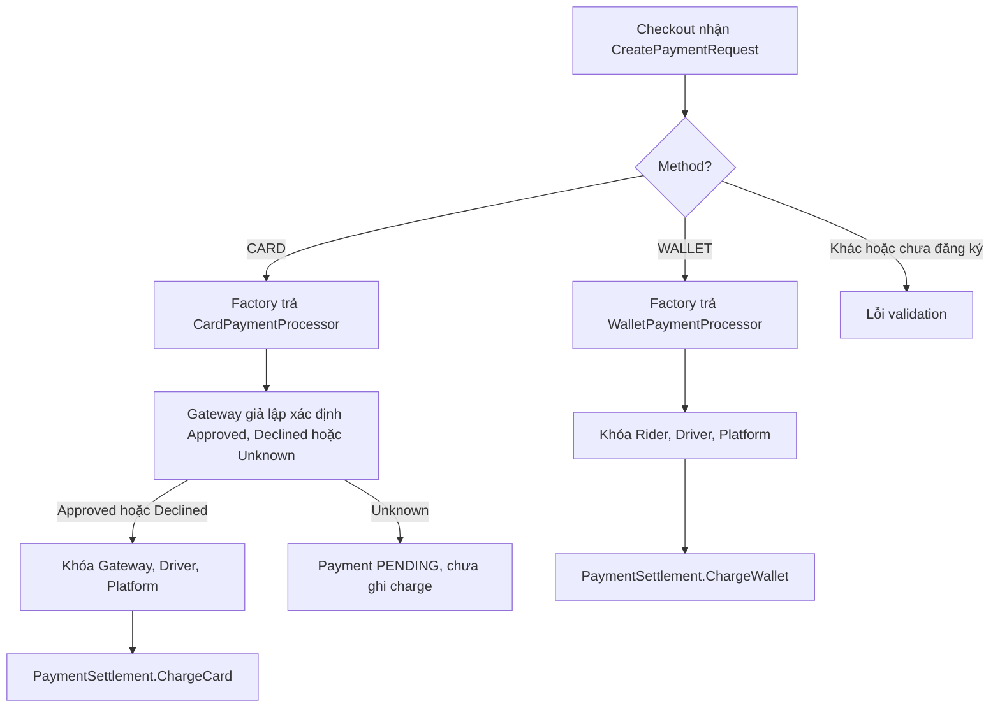
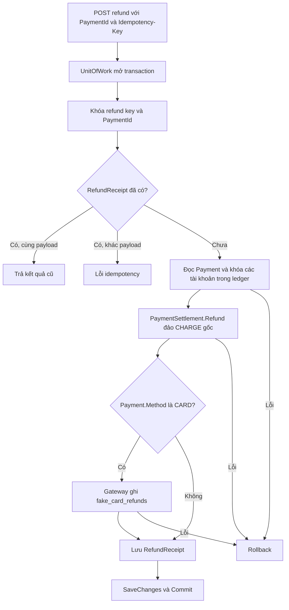

# Factory và refund trong Payment Service

Tài liệu này đi theo code hiện tại. Ví dụ dùng chuyến **100.000đ**, cấu hình `DriverRate = 0.8`: tài xế nhận 80.000đ, nền tảng nhận 20.000đ.

## 1. Factory là gì?

Factory ở đây là một **bộ chọn cách thanh toán**. Nó không thu tiền và không ghi database. Nó nhận `PaymentMethod`, rồi trả về processor tương ứng:

| `Method` | Processor | Tiền được lấy từ đâu? |
| --- | --- | --- |
| `WALLET` | `WalletPaymentProcessor` | Ví Rider |
| `CARD` | `CardPaymentProcessor` | Tài khoản Gateway giả lập |

Code ở `src/PaymentService/PaymentService.Application/Services/PaymentMethodProcessorFactory.cs`:

```csharp
private readonly IReadOnlyDictionary<PaymentMethod, IPaymentMethodProcessor> _processors =
    processors.ToDictionary(processor => processor.Method);

public IPaymentMethodProcessor For(PaymentMethod method) =>
    _processors.TryGetValue(method, out var processor)
        ? processor
        : throw new ValidationException($"Payment method {method} is not configured.");
```

`processors` đến từ DI. `PaymentService.Infrastructure/DependencyInjection.cs` luôn đăng ký Wallet processor. Card processor và `FakeCardAuthorizationGateway` chỉ được đăng ký ở `Development`/`Testing`. Nếu Card không được đăng ký, `For(CARD)` báo lỗi.



Trong `PaymentCheckoutService.CreateInsideTransactionAsync`, đoạn chọn và chạy processor là:

```csharp
var factory = processors ?? new PaymentMethodProcessorFactory(
    [new WalletPaymentProcessor(accounts, options)]);
await factory.For(request.Method).SettleAsync(payment, request, ct);
await payments.AddAsync(payment, ct);
```

Ở ứng dụng chạy thật, DI cấp factory đã đăng ký. Nhánh `??` là đường dự phòng cho chỗ tạo `PaymentCheckoutService` trực tiếp. Trước đó checkout đã khóa `IdempotencyKey` và `TripId`, kiểm tra payment cũ. Cùng key và payload thì trả payment cũ, không gọi processor lần nữa.

### Ai mở transaction?

`PaymentCheckoutService.CreateAsync` gọi `unitOfWork.ExecuteAsync(...)`. Với tin RabbitMQ, `RideCompletedConsumer` gọi `unitOfWork.ExecuteAsync(...)` và chạy `CreateInsideTransactionAsync` bên trong nó. `UnitOfWork` mở transaction, chạy hàm được truyền vào, `SaveChanges`, rồi `Commit`; nếu có lỗi thì `Rollback`. Processor và Domain **không tự mở transaction**.

## 2. Card được thu như thế nào?

`CardPaymentProcessor` gọi `gateway.AuthorizeAsync(token, key, amount)` rồi chuyển kết quả cho `PaymentSettlement.ChargeCard`. Gateway giả lập lưu kết quả authorization theo key trong `fake_card_authorizations`; nó không sửa số dư.

Với `Approved`, `ChargeCard` gọi `MoneyRules.Split(amount, DriverRate)` rồi ghi ba dòng ledger:

| Tài khoản | CHARGE | Số dư Rider |
| --- | ---: | --- |
| Gateway | −100.000đ | Không đổi |
| Driver | +80.000đ | Không đổi |
| Platform | +20.000đ | Không đổi |

`Declined` tạo payment `FAILED`, không ghi charge. `Unknown` giữ payment `PENDING`, không ghi charge và chưa có event kết quả cuối cho Trip.

## 3. Refund chạy thế nào?

Refund **không đi qua factory** vì phương thức thanh toán đã nằm trên `Payment`. `RefundAppService` đọc payment và các dòng CHARGE đã lưu, rồi gọi `PaymentSettlement.Refund` cho cả Wallet lẫn Card.



Code chính ở `src/PaymentService/PaymentService.Application/Services/RefundAppService.cs`:

```csharp
var accountIds = payment.Entries.Select(e => e.AccountId).Distinct().ToArray();
var locked = await accounts.GetForUpdateAsync(accountIds, ct);
PaymentSettlement.Refund(payment, locked);
if (payment.Method == PaymentMethodType.Card)
    await cardGateway.RefundAsync(payment.IdempotencyKey, idempotencyKey, payment.Amount, ct);
await refunds.AddAsync(new RefundReceipt(idempotencyKey, paymentId, reason, response, DateTime.UtcNow), ct);
```

Code thật kiểm tra `cardGateway` có được cấu hình trước khi gọi. Mọi thay đổi ở đây nằm trong **cùng một transaction**: số dư, ledger REFUND, `RefundReceipt` và bản ghi refund giả lập cùng commit hoặc cùng rollback.

### Vì sao refund dùng ledger gốc?

`PaymentSettlement.Refund` lấy đúng ba dòng `CHARGE` của payment rồi đổi dấu từng dòng. Ví dụ Card đã charge `Gateway −100.000`, `Driver +80.000`, `Platform +20.000` thì refund ghi `Gateway +100.000`, `Driver −80.000`, `Platform −20.000`. Nếu `DriverRate` sau này đổi thành `0.75`, refund vẫn dùng **80.000/20.000 của lần charge gốc**.

Chỉ payment `SUCCEEDED` và chưa refund mới được hoàn. Gọi lại cùng refund key và cùng lý do trả `RefundReceipt` cũ; không đảo ledger thêm lần nữa. Card gateway giả lập cũng chỉ lưu một refund cho authorization đã `Approved`.

## 4. Tìm code theo thứ tự

1. `PaymentService.Application/Services/PaymentCheckoutService.cs` — kiểm tra request, chống payment trùng, gọi factory.
2. `PaymentService.Application/Services/PaymentMethodProcessorFactory.cs` — chọn processor.
3. `PaymentService.Application/Services/WalletPaymentProcessor.cs` hoặc `CardPaymentProcessor.cs` — khóa tài khoản và gọi Domain.
4. `PaymentService.Domain/Services/PaymentSettlement.cs` — tính charge và đảo ledger khi refund.
5. `PaymentService.Application/Services/RefundAppService.cs` — chống refund trùng, gọi Domain và gateway Card.
6. `PaymentService.Infrastructure/Messaging/FakeCardAuthorizationGateway.cs` — lưu authorization/refund giả lập.
7. `PaymentService.Infrastructure/Repositories/UnitOfWork.cs` — transaction, commit/rollback.
