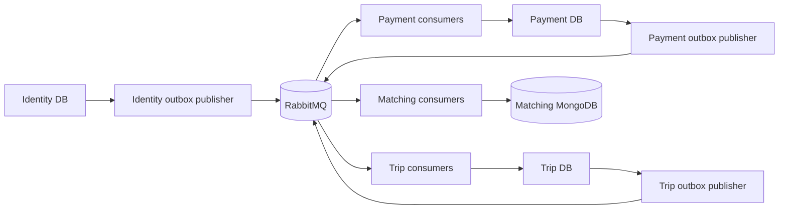
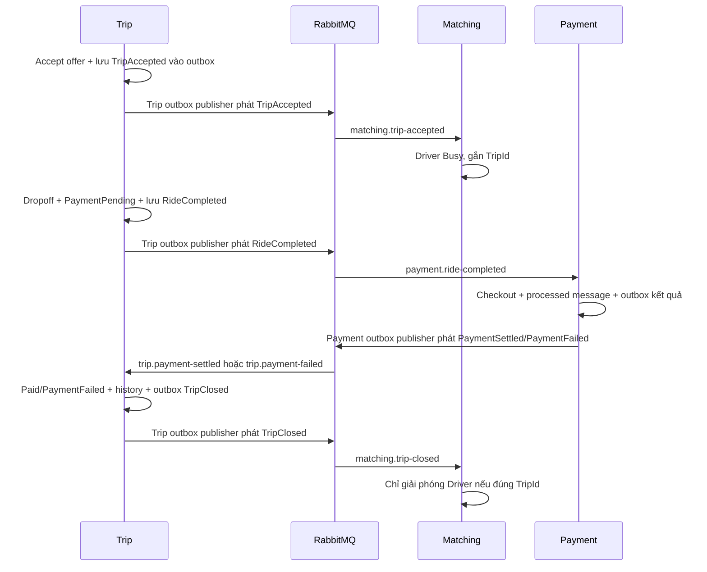

# RabbitMQ trong đồ án SwiftRide

Tài liệu này mô tả **code hiện tại của SwiftRide**: event được tạo ở đâu, đi qua RabbitMQ thế nào, service nào nhận và xử lý. Phần 2 giải thích BuildingBlocks và những project dùng chung mà các service tham chiếu.

**Tóm tắt cấu hình:** Các queue ứng dụng trên broker đang chạy là `classic`, `durable=true`; exchange do MassTransit tạo là `fanout`. Mỗi receive endpoint có `PrefetchCount=16` theo mặc định của project, retry lỗi tạm thời tối đa 3 lần với khoảng chờ tăng dần, và chuyển tin xử lý thất bại sang `<queue>_error`. Code **chưa cấu hình xử lý tuần tự từng queue**, giới hạn chiều dài queue, quorum queue hay volume riêng cho dữ liệu RabbitMQ. Chi tiết và vị trí code ở các mục dưới.

## 1. Bức tranh tổng thể

**Báo giá đã chuyển sang event:** `POST /trips` trả 202/Requested, phát
`QuoteRequested` qua Trip Outbox. Matching lưu quote và Outbox nhúng trong Mongo
`quoteResults`, phát `QuoteCalculated`/`QuoteFailed` để Trip cập nhật trạng thái.
Client chờ Quoted trước confirm; `/match` vẫn dùng REST.
Xem [luồng và xử lý lỗi báo giá](QUOTE-BAT-DONG-BO.md).

SwiftRide có bốn service tham gia luồng event:

| Service | Phát event | Nhận event |
| --- | --- | --- |
| Identity | `UserRegistered`, `DriverRegistered` | Không có consumer RabbitMQ |
| Trip | `TripAccepted`, `RideCompleted`, `TripClosed` | `PaymentSettled`, `PaymentFailed` |
| Payment | `PaymentSettled`, `PaymentFailed` | `UserRegistered`, `RideCompleted` |
| Matching | Không phát event trong luồng này | `DriverRegistered`, `TripAccepted`, `TripClosed` |

RabbitMQ **chuyển tin giữa các service**. Database của mỗi service vẫn là nơi lưu trạng thái nghiệp vụ của service đó. Ví dụ, Payment cập nhật ví trong PostgreSQL; RabbitMQ không lưu số dư ví.



Trong code, một event như `UserRegistered` là **một kiểu dữ liệu C#** và mỗi instance được publish là **một tin nhắn**. RabbitMQ vận chuyển bản tuần tự hóa của tin đó. `UserRegistered` không phải tên queue.

## 2. BuildingBlocks là gì?

`src/BuildingBlocks` là nơi đặt **code dùng chung** để nhiều service không phải tự định nghĩa lại cùng một contract hoặc cấu hình RabbitMQ. Nó là các project/thư viện C# được tham chiếu lúc build, **không phải một microservice chạy riêng**, không có database riêng và không tự xử lý nghiệp vụ.

Trong phần RabbitMQ có hai project chính:

| Project | Chứa gì? | Ai dùng? |
| --- | --- | --- |
| `SwiftRide.Contracts` | Định nghĩa bảy event, metadata và tên queue | Cả publisher và consumer |
| `SwiftRide.Messaging` | Cấu hình MassTransit/RabbitMQ, đọc `.env`, retry, filter log, middleware HTTP | Bốn API/service |

Hãy hình dung `Contracts` là **mẫu tin và địa chỉ nhận**, còn `Messaging` là **bộ lắp đặt kết nối và quy tắc vận chuyển**. Code thực sự tạo ví, đổi trạng thái chuyến hoặc tài xế vẫn ở Identity, Payment, Trip và Matching.

### 2.1. `SwiftRide.Contracts`: hai phía phải hiểu cùng một tin

Thư mục `src/BuildingBlocks/SwiftRide.Contracts/Events/` chứa:

- `EventMetadata.cs`: interface `IIntegrationEvent` yêu cầu mọi event có `EventId`, `CorrelationId`, `CausationId`, `OccurredAt`, `SchemaVersion`.
- `UserRegistered.cs`, `DriverRegistered.cs`, `TripAndPaymentEvents.cs`: kiểu dữ liệu và payload của bảy event.
- `QueueNames.cs`: hằng tên queue của **consumer**, ví dụ `payment.user-registered`.

Ví dụ rút gọn:

```csharp
public sealed record TripAccepted(
    Guid EventId,
    Guid CorrelationId,
    Guid? CausationId,
    DateTime OccurredAt,
    Guid TripId,
    Guid DriverId,
    int SchemaVersion = EventSchema.V1) : IIntegrationEvent;
```

Trip tạo `TripAccepted`; Matching nhận cùng kiểu `TripAccepted`. Nhờ tham chiếu chung project Contracts, hai bên thống nhất tên event và các trường payload. **Contracts chỉ mô tả tin**, không tự publish hoặc consume.

| Metadata | Ý nghĩa trong SwiftRide |
| --- | --- |
| `EventId` | ID của một event; giữ nguyên nếu outbox gửi lại; consumer dùng để chống xử lý trùng |
| `CorrelationId` | ID của **workflow**: `UserId` khi đăng ký, `TripId` khi đi chuyến/thanh toán |
| `CausationId` | `EventId` của event đã gây ra event hiện tại; `null` với event bắt nguồn từ thao tác HTTP |
| `OccurredAt` | Thời điểm nghiệp vụ tạo event, theo UTC |
| `SchemaVersion` | Phiên bản payload; hiện là `1` |

Ví dụ chuỗi ID của một chuyến:

```text
RideCompleted:  EventId = R, CorrelationId = TripId, CausationId = null
PaymentSettled: EventId = P, CorrelationId = TripId, CausationId = R
TripClosed:     EventId = C, CorrelationId = TripId, CausationId = P
```

`CorrelationId` giúp gom các tin cùng chuyến; `CausationId` cho biết tin nào gây ra tin tiếp theo. `X-Correlation-Id` của HTTP chỉ là ID để truy vết **request HTTP**; nó không thay `TripId` hoặc `UserId` trong event.

### 2.2. `SwiftRide.Messaging`: kết nối và quy tắc chung

Thư mục `src/BuildingBlocks/SwiftRide.Messaging/` có các phần quan trọng:

| File | Công việc |
| --- | --- |
| `DotEnvLoader.cs` | Đọc `.env` trước khi API tạo cấu hình; không ghi đè biến môi trường đã tồn tại |
| `RabbitMqOptions.cs` | Chứa host, port, virtual host, username, password, giới hạn retry và prefetch |
| `MessagingExtensions.cs` | Cung cấp `AddSwiftRideMessaging(...)` để đăng ký MassTransit, RabbitMQ, endpoint và retry |
| `IntegrationEventPublishFilter.cs` | Gắn `EventId` vào transport `MessageId`, gắn workflow ID vào transport `CorrelationId`, log kết quả publish |
| `IntegrationEventConsumeFilter.cs` | Tạo log scope và log kết quả xử lý, queue, số lần retry; lỗi được ném tiếp để MassTransit xử lý |
| `IntegrationEventLogFields.cs` | Lấy `TripId`/`UserId` và tên queue tương ứng từ từng loại event |
| `IntegrationEventDescriptions.cs` | Diễn giải tên từng event bằng tiếng Việt trong log |
| `CorrelationLoggingMiddleware.cs` | Gắn ID theo dõi request HTTP và trả `X-Correlation-Id` trong response |

Các API gọi `DotEnvLoader.Load()` trước `WebApplication.CreateBuilder(args)`. Khóa `.env` như `RabbitMQ__HostName` được ASP.NET Core ánh xạ thành `RabbitMQ:HostName`, rồi bind vào `RabbitMqOptions`. Khi chạy trong môi trường `Testing`, `AddSwiftRideMessaging` dùng transport in-memory để test không cần RabbitMQ thật.

Trong `.env` hiện có `RabbitMQ__HostName`, `RabbitMQ__Port`, `RabbitMQ__VirtualHost`, `RabbitMQ__UserName`, `RabbitMQ__Password`. Các giá trị retry/prefetch **không được ghi trong `.env`**, nên dùng mặc định ở `RabbitMqOptions.cs`. `DotEnvLoader` không ghi đè biến môi trường đã có sẵn, vì vậy CI/Docker có thể cấp giá trị khác. Không nhầm cổng `5672` (AMQP để service kết nối) với `15672` (giao diện quản trị của container trong `docker-compose.yml`).

```text
.env → DotEnvLoader.Load() → WebApplication.CreateBuilder(args)
     → AddInfrastructure(...) → AddSwiftRideMessaging(...)
     → RabbitMqOptions → MassTransit kết nối RabbitMQ
```

`AddSwiftRideMessaging` cấu hình kết nối RabbitMQ, receive endpoint bền vững, prefetch, publisher confirmation, retry giới hạn và các filter log. **Nó không tự biết Payment cần nhận `UserRegistered` hoặc Matching cần nhận `TripClosed`**. Mỗi service phải khai báo consumer của mình qua tham số `configureConsumers`.

Ví dụ trong `MatchingService.Infrastructure/DependencyInjection.cs`:

```csharp
services.AddSwiftRideMessaging(configuration, environment,
    configureConsumers: bus =>
    {
        bus.AddConsumer<DriverRegisteredConsumer>()
            .Endpoint(endpoint => endpoint.Name = QueueNames.MatchingDriverRegistered);
        bus.AddConsumer<TripAcceptedConsumer>()
            .Endpoint(endpoint => endpoint.Name = QueueNames.MatchingTripAccepted);
        bus.AddConsumer<TripClosedConsumer>()
            .Endpoint(endpoint => endpoint.Name = QueueNames.MatchingTripClosed);
    });
```

Dòng `AddConsumer<DriverRegisteredConsumer>()` nói MassTransit tạo consumer cho kiểu `DriverRegistered`. `Endpoint(...Name...)` đặt tên queue nhận là `matching.driver-registered`. Khi tin hợp lệ vào queue, MassTransit gọi `Consume(...)`; consumer gọi application service/handler; handler gọi repository để lưu MongoDB. BuildingBlocks chỉ cung cấp cách đăng ký chung, còn **Matching quyết định xử lý gì**.

## 3. Exchange, queue và binding trong code này

Ba khái niệm cần tách riêng:

| Khái niệm | Vai trò |
| --- | --- |
| Exchange | Nơi RabbitMQ nhận tin được publish rồi định tuyến |
| Queue | Nơi giữ tin chờ consumer lấy ra |
| Binding | Liên kết exchange với exchange/queue để tin đi đến nơi nhận |

**“Loại queue” và “loại exchange” là hai câu hỏi khác nhau:**

| Thành phần | Đang dùng | Dấu vết trong code/broker |
| --- | --- | --- |
| Queue nhận event | `classic`, durable, không tự xóa | `MessagingExtensions.cs` đặt `rabbitEndpoint.Durable = true`; broker hiện báo `type=classic`, `auto_delete=false` |
| Publish exchange cho từng event | `fanout`, durable | MassTransit tạo mặc định; broker có `SwiftRide.Contracts.Events:TripAccepted`, `...:RideCompleted`, v.v. |
| Receive endpoint exchange | `fanout`, durable | Broker có exchange `matching.trip-accepted`, `payment.ride-completed`, v.v. |
| Routing key/binding key của luồng event | Không đặt key tùy chỉnh | Binding từ exchange event đến endpoint exchange có routing key rỗng |

Code không đặt `x-queue-type`, nên queue type phụ thuộc vào **default queue type của vhost/broker khi queue được tạo**. Trên broker hiện tại, cả bảy queue ứng dụng là `classic`; code không yêu cầu `quorum`. Một classic queue không được nhân bản sang nhiều node RabbitMQ. `Durable=true` giữ định nghĩa queue qua restart broker, nhưng cần phân biệt với độ bền của **message** và ổ đĩa/container. [RabbitMQ giải thích queue type và durability](https://www.rabbitmq.com/docs/queues), [classic queue](https://www.rabbitmq.com/docs/classic-queues).

Code dùng `IPublishEndpoint.Publish(event)`, tức **publish theo kiểu event C#**, không gọi `Send` đến một queue cụ thể. MassTransit tạo publish exchange cho loại event và cấu hình binding từ publish exchange đến receive endpoint của consumer. Với cấu hình RabbitMQ mặc định đang dùng, các exchange này dùng topology **fanout**; code không đặt direct exchange hay routing key/binding key tùy chỉnh. Tin đến đúng queue vì queue đó được đăng ký consumer cho **đúng kiểu event**, và MassTransit tự cấu hình binding. `QueueNames.MatchingTripAccepted` là **tên queue**, không phải routing key.

Trong danh sách exchange RabbitMQ vẫn có exchange mặc định `""` và `amq.direct` kiểu **direct**. Đó là thành phần sẵn có của broker; các lệnh `Publish(event)` trong SwiftRide đi qua exchange `fanout` do MassTransit tạo. Broker cũng có exchange `SwiftRide.Contracts.Events:IIntegrationEvent` vì bảy event triển khai interface này; sự hiện diện của nó **không có nghĩa là có thêm một queue nhận event**. [MassTransit mô tả topology RabbitMQ mặc định](https://masstransit.io/documentation/configuration/transports/rabbitmq).

Sơ đồ khái niệm cho `UserRegistered`:

```text
Identity: Publish(UserRegistered)
    → publish exchange của kiểu UserRegistered
    → binding do MassTransit tạo
    → receive endpoint/queue payment.user-registered
    → UserRegisteredConsumer.Consume(...)
```

Nếu sau này có thêm một service đăng ký `IConsumer<UserRegistered>` trên queue khác, fanout topology có thể đưa **mỗi queue** một bản tin. Nhiều consumer cùng đọc **một queue** thì chia nhau các tin của queue đó. Tên publish exchange do MassTransit suy ra từ kiểu message; đừng nhầm tên exchange với hằng `QueueNames`.

## 4. Bảy event đang đi đâu?

| Event | Được tạo/phát bởi | Queue nhận | Consumer và kết quả |
| --- | --- | --- | --- |
| `UserRegistered` | Identity | `payment.user-registered` | Payment tạo ví số dư 0, gửi lại không reset ví |
| `DriverRegistered` | Identity | `matching.driver-registered` | Matching đăng ký Driver, giữ nguyên trạng thái/vị trí nếu đã tồn tại |
| `TripAccepted` | Trip | `matching.trip-accepted` | Matching đánh dấu Driver Busy cho TripId đó |
| `RideCompleted` | Trip | `payment.ride-completed` | Payment checkout, lưu thanh toán và event kết quả |
| `PaymentSettled` | Payment | `trip.payment-settled` | Trip chuyển `PaymentPending` → `Paid`, ghi `TripClosed` |
| `PaymentFailed` | Payment | `trip.payment-failed` | Trip chuyển `PaymentPending` → `PaymentFailed`, ghi `TripClosed` |
| `TripClosed` | Trip | `matching.trip-closed` | Matching giải phóng đúng Driver của chuyến đã đóng |

Tên queue nằm ở `QueueNames.cs`; code đăng ký từng consumer nằm trong `DependencyInjection.cs` của Payment, Trip và Matching. Identity chỉ publish nên `AddSwiftRideMessaging(...)` ở Identity không đăng ký consumer.

## 5. Luồng đăng ký tài khoản: từ HTTP đến ví/Driver

1. Client gọi API đăng ký ở Identity.
2. `UserRepository.AddAsync` thêm User và thêm `UserRegistered` vào **Identity outbox** trong cùng lần `SaveChangesAsync`. Nếu là tài xế, repository còn thêm `DriverRegistered`.
3. `IdentityOutboxPublisher` là `BackgroundService`: khoảng **10 giây** đọc các row outbox chưa có `ProcessedAt`, tối đa 50 row theo thời gian. Nó đọc **database Identity**, không ngồi chờ nhận tin từ queue.
4. Publisher deserialize payload rồi gọi `IPublishEndpoint.Publish(...)`. Publish filter đặt `MessageId = EventId`, `CorrelationId = UserId` trên envelope; MassTransit đưa tin đến RabbitMQ.
5. MassTransit định tuyến `UserRegistered` đến `payment.user-registered`; `UserRegisteredConsumer` gọi `AccountRegistrationService` tạo ví. `DriverRegistered` đến `matching.driver-registered`; `DriverRegisteredConsumer` gọi `DriverAppService` tạo Driver.
6. Sau khi publish hoàn tất, Identity đặt `ProcessedAt` cho row outbox. Nếu worker chết trước bước này, lần sau có thể phát lại **cùng EventId**; phía consumer phải xử lý idempotent.

Identity publisher cũng có phần **backfill** cho user cũ chưa có event outbox. Nó không tạo ví trực tiếp từ Identity.

## 6. Luồng chuyến đi và thanh toán



Ở bước dropoff, `RideCompleted` **chưa được gửi ngay**: Trip lưu nó cùng trạng thái `PaymentPending`, sau đó `TripOutboxPublisher` đọc DB và phát. Payment nhận event trong `RideCompletedConsumer`, checkout và ghi payment/balance/ledger, dấu đã xử lý `RideCompleted`, cùng outbox `PaymentSettled` **hoặc** `PaymentFailed` trong transaction Payment. `PaymentOutboxPublisher` đọc outbox Payment khoảng **5 giây** một lần rồi phát kết quả.

Trip nhận kết quả trong `PaymentSettledConsumer` hoặc `PaymentFailedConsumer`; cả hai chuyển cho `TripPaymentResultHandler`. Handler kiểm tra `TripId`, `CausationId` trỏ đúng `RideCompleted`, số tiền và trạng thái hiện tại. Trip cập nhật state/history, ghi `TripClosed` vào outbox và dấu đã xử lý kết quả trong cùng lần lưu. `TripOutboxPublisher` phát các event Trip theo batch khoảng **5 giây** một lần và có cơ chế claim row để các instance không cùng lấy một row.

Matching nhận `TripClosed` trong `TripClosedConsumer`, chuyển cho `TripLifecycleHandler`. Repository chỉ đổi Driver về Available nếu `StatusTripId` đúng `TripId` trong event; event cũ không giải phóng tài xế đã nhận chuyến mới. Matching cũng ghi nhận event đóng đến trước event nhận chuyến để không mở lại chuyến đã đóng.

## 7. Retry bắt lỗi như thế nào?

`src/BuildingBlocks/SwiftRide.Messaging/MessagingExtensions.cs` gắn `UseMessageRetry(...)` lên **mỗi receive endpoint được đăng ký**. Các giá trị mặc định nằm trong `RabbitMqOptions.cs`:

| Tham số | Mặc định | Tác dụng |
| --- | ---: | --- |
| `RetryLimit` | 3 | Tối đa 3 lần thử lại **sau lần xử lý đầu tiên** |
| `MinRetryIntervalMs` | 1000 | Khoảng chờ thấp nhất |
| `MaxRetryIntervalMs` | 10000 | Khoảng chờ cao nhất |
| `RetryIntervalDeltaMs` | 2000 | Tham số cho lịch chờ exponential của MassTransit |
| `PrefetchCount` | 16 | Số tin chưa ACK tối đa được cấp trước cho receive endpoint/consumer; **không phải** 16 tin/giây |

Ví dụ `RideCompletedConsumer.Consume(...)` gặp lỗi DB tạm thời và ném exception:

```text
RabbitMQ giao RideCompleted → Payment consumer thử lần đầu (RetryAttempt=0)
    → lỗi → MassTransit giữ tin để retry ngắn hạn
    → thử lại tối đa 3 lần theo Exponential(...)
    → thành công: ACK tin
    → vẫn lỗi: chuyển sang payment.ride-completed_error
```

MassTransit retry này diễn ra **trong bộ nhớ của tiến trình đang consume**, giữ slot xử lý trong lúc chờ; code hiện **không cấu hình delayed redelivery** sau vài phút/giờ. Các exception `JsonException`, `ArgumentException`, `FormatException` được `retry.Ignore<...>()`: không thử lại theo lịch trên, nhưng vẫn đi qua cơ chế lỗi và có thể vào `_error`. Các exception khác được retry theo giới hạn. `IntegrationEventConsumeFilter.cs` log `RetryAttempt`, exception và kết quả rồi **ném lỗi tiếp**; filter không tự ACK hoặc xóa tin. [MassTransit về retry và error queue](https://masstransit.io/documentation/concepts/exceptions).

Sau khi consumer chạy xong không lỗi, MassTransit ACK; code trong `IConsumer<T>` không gọi `BasicAck`. Nếu hết retry hoặc lỗi bị bỏ qua retry, MassTransit chuyển tin lỗi sang `<tên-queue>_error`. `_error` là queue giữ tin lỗi để kiểm tra, **không phải một worker tự động xử lý lại**. Tin đến queue nhưng không có consumer phù hợp có thể vào `<tên-queue>_skipped`. Khi phát lại tin lỗi sau khi sửa nguyên nhân, giữ `EventId` gốc để logic chống trùng hoạt động.

**Retry của consumer không phải retry của publisher.** Publisher Identity/Trip/Payment có vòng đọc outbox riêng. Nếu publish lỗi, row outbox vẫn pending và worker thử lại ở lượt quét sau. `IdentityOutboxPublisher` quét khoảng 10 giây; `TripOutboxPublisher` và `PaymentOutboxPublisher` quét khoảng 5 giây. Chúng không đọc queue RabbitMQ để lấy việc; chúng đọc bảng outbox trong DB của mình.

## 8. Nếu một thành phần bị sập thì sao?

**Outbox giải quyết khoảng cách giữa DB và RabbitMQ.** Identity lưu User và event vào outbox cùng lần `SaveChangesAsync`; Trip và Payment cũng lưu event kết quả cùng dữ liệu nghiệp vụ của mình. Worker riêng mới publish. Đây là code trong `UserRepository.AddAsync`, `TripRepository.AddOutboxEvent`/`SaveChangesAsync`, `RideCompletedConsumer` và ba `*OutboxPublisher`.

| Sự cố | Hành vi theo thiết kế hiện tại |
| --- | --- |
| API/publisher chết **trước khi lưu DB** | Transaction chưa commit; không có trạng thái nghiệp vụ/event outbox mới để phát. |
| Đã lưu DB + outbox, publisher chết hoặc RabbitMQ tạm mất kết nối | Row outbox còn pending; worker thử lại khi chạy/kết nối được. |
| Publish đã tới broker nhưng publisher chết **trước khi đặt `ProcessedAt`** | Outbox có thể phát lại cùng `EventId`; consumer phải bỏ qua duplicate hợp lệ. |
| Consumer/service nhận bị tắt **sau khi queue và binding đã tồn tại** | Tin được xếp trong queue durable; khi consumer kết nối lại, nó tiếp tục nhận. Tin đã giao nhưng chưa ACK có thể được giao lại. |
| Consumer chết trong khi đang xử lý, trước ACK | RabbitMQ có thể giao lại tin khi kết nối đóng; cần xử lý idempotent. |
| Consumer ném lỗi nhiều lần | MassTransit retry ngắn hạn, sau đó chuyển sang `<queue>_error`; không tự hoàn tất nghiệp vụ. |
| RabbitMQ container restart khi dữ liệu container còn nguyên | Queue durable được khai báo lại/khôi phục; việc khôi phục **tin** còn phụ thuộc cách broker lưu message. Kiểm tra outbox và queue sau restart. |
| RabbitMQ process/container dừng hẳn | `docker-compose.yml` hiện không đặt `restart:` cho RabbitMQ; container không được cấu hình tự khởi động lại bằng Compose. Các publisher giữ row outbox pending khi chưa publish thành công. |
| RabbitMQ container bị xóa/tạo lại bằng `docker compose down` rồi `up` | `docker-compose.yml` hiện **không mount volume cho RabbitMQ**; dữ liệu queue trong container cũ không được bảo đảm giữ lại. Outbox chỉ phát lại các row còn pending, không tự tái tạo mọi tin đã đánh dấu `ProcessedAt`. |

**Giới hạn quan trọng khi khởi động lần đầu:** consumer là bên khai báo receive queue/binding thông qua `AddConsumer(...).Endpoint(...)` và `cfg.ConfigureEndpoints(context)`. Nếu publisher phát event **trước khi endpoint đích từng được tạo/bind**, publisher confirm chỉ xác nhận broker nhận publish, **không chứng minh tin đã vào queue**. Tin không có binding phù hợp có thể không được xếp vào queue. Khi triển khai, cần bảo đảm topology/consumer đích đã tồn tại trước khi phát event đầu tiên; các lần service đích tắt **sau khi queue đã tồn tại** là tình huống khác. [MassTransit về topology publish/subscribe](https://masstransit.io/documentation/configuration/transports/rabbitmq), [RabbitMQ về publisher confirm và consumer ACK](https://www.rabbitmq.com/docs/confirms).

`host.PublisherConfirmation = true` trong `MessagingExtensions.cs` xác nhận broker đã nhận publish. Nó **không phải ACK của consumer** và không xác nhận Payment đã tạo ví hoặc Trip đã đổi trạng thái. Outbox + idempotency xử lý việc phát lại; không có bảo đảm “đúng một lần” trên toàn hệ thống. Payment lưu `ProcessedMessages`, Trip lưu `ProcessedPaymentResults`; Matching kiểm tra `StatusTripId`, thời điểm event và chuyến đã đóng trên document Driver. [RabbitMQ về ACK và redelivery](https://www.rabbitmq.com/docs/confirms).

## 9. Nếu nhiều traffic tới queue: xử lý thứ tự nào?

RabbitMQ xếp tin trong **từng queue** theo thứ tự chúng **đến queue**. Bảy event nằm ở **bảy queue khác nhau**, nên không có một thứ tự toàn cục giữa `matching.trip-accepted`, `payment.ride-completed` và `trip.payment-settled`. Outbox publisher cũng là ba worker khác nhau; thứ tự workflow phụ thuộc quan hệ nghiệp vụ và kiểm tra trạng thái, không phụ thuộc một queue chung. [RabbitMQ về thứ tự queue](https://www.rabbitmq.com/docs/queues).

Ví dụ 100 tin cùng vào `payment.ride-completed`:

1. Tin chờ trong queue. `PrefetchCount=16` ở `MessagingExtensions.cs` giới hạn số tin được RabbitMQ cấp trước nhưng **chưa ACK** cho receive endpoint/consumer. Đây không phải giới hạn queue chỉ chứa 16 tin; các tin còn lại tiếp tục chờ trong queue.
2. MassTransit giao tin cho các lượt `RideCompletedConsumer.Consume(...)`. Code **không đặt `ConcurrentMessageLimit=1`**, `SingleActiveConsumer` hay partition theo `TripId`; vì vậy không hứa xử lý từng tin một hoặc hoàn tất theo FIFO. Nếu có nhiều instance Payment cùng kết nối một queue, chúng chia việc trên queue đó; một tin cụ thể được một instance xử lý tại một thời điểm, trừ khi bị giao lại.
3. Tin A có thể bắt đầu trước B nhưng B hoàn tất/ACK trước A. Retry hoặc consumer bị sập có thể làm tin A được giao lại sau B. Vì thế **thứ tự vào queue ≠ thứ tự hoàn tất nghiệp vụ**.
4. Khi tốc độ đến lớn hơn tốc độ xử lý, `messages_ready` tăng; nếu consumer đã nhận nhưng chưa ACK, `messages_unacknowledged` tăng. Code hiện không cấu hình TTL, `x-max-length`, rate limiter hay dead-letter policy cho backlog; không có bảo đảm backlog vô hạn khi tài nguyên broker cạn.

Ở **phía outbox** cũng có thứ tự lấy row nhưng không biến toàn hệ thống thành FIFO: Identity lấy tối đa 50 row/lượt và `OrderBy(OccurredAt).ThenBy(Id)`; Payment lấy tối đa 50 row/lượt với `FOR UPDATE SKIP LOCKED`; Trip claim tối đa 50 row/lượt với `UPDLOCK, READPAST` và lease 120 giây. Nhiều worker/instance có thể chia batch; retry và thời gian xử lý khác nhau làm thứ tự publish thực tế thay đổi. Xem `IdentityOutboxPublisher.cs`, `PaymentOutboxPublisher.cs`, `TripOutboxPublisher.cs`.

Vì không dựa vào FIFO tuyệt đối, consumer kiểm tra **trạng thái và ID**: Payment chống xử lý trùng `RideCompleted`, Trip chỉ nhận kết quả thanh toán khớp chuyến đang `PaymentPending`, Matching không giải phóng Driver đang chạy chuyến khác và bỏ qua event cũ. Nếu cần FIFO tuyệt đối cho mỗi `TripId` trong tương lai, phải thiết kế partition/serial processing riêng; cấu hình hiện tại **chưa có**. [RabbitMQ về prefetch](https://www.rabbitmq.com/docs/consumer-prefetch), [MassTransit về concurrency](https://masstransit.io/documentation/configuration).

## 10. Log và cách lần theo một tin

Publish/consume filter trong BuildingBlocks ghi `EventType`, `EventId`, `MessageId`, `CorrelationId`, `CausationId`, `TripId` hoặc `UserId`, `Queue`, `Outcome`. Consumer ghi thêm `RetryAttempt` (lần đầu là 0). HTTP middleware trả `X-Correlation-Id` để tìm log của request gốc. Muốn tìm toàn bộ luồng chuyến đi, tra `CorrelationId = TripId`; muốn biết `PaymentSettled` đến từ `RideCompleted` nào, tra `CausationId`.

Ví dụ khi Payment không tạo được kết quả checkout:

1. Tìm log `Queue=payment.ride-completed` và `EventId` của `RideCompleted`.
2. Xem `RetryAttempt`, exception và queue `payment.ride-completed_error` nếu đã hết retry.
3. Kiểm tra row outbox `RideCompleted` ở Trip đã được phát chưa, và `ProcessedMessages`/outbox kết quả ở Payment đã ghi chưa.
4. Dùng `TripId`/`CorrelationId` để nối log giữa Trip và Payment; dùng `CausationId` của event kết quả để xác nhận nó xuất phát từ `RideCompleted` nào.

## 11. Nơi nên mở code khi đọc tiếp

| Muốn hiểu | Mở file |
| --- | --- |
| Hình dạng event và tên queue | `src/BuildingBlocks/SwiftRide.Contracts/Events/` |
| Cấu hình RabbitMQ, retry, đăng ký endpoint | `src/BuildingBlocks/SwiftRide.Messaging/MessagingExtensions.cs` |
| Giá trị mặc định của retry và prefetch | `src/BuildingBlocks/SwiftRide.Messaging/RabbitMqOptions.cs` |
| Queue nào nhận event nào | `src/BuildingBlocks/SwiftRide.Contracts/Events/QueueNames.cs` và `DependencyInjection.cs` của từng service |
| Metadata transport và log | `IntegrationEventPublishFilter.cs`, `IntegrationEventConsumeFilter.cs` |
| Identity tạo event khi lưu User | `src/IdentityService/IdentityService.Infrastructure/Repositories/UserRepository.cs` |
| Worker đọc outbox Identity | `src/IdentityService/IdentityService.Infrastructure/Outbox/IdentityOutboxPublisher.cs` |
| Trip phát event | `src/TripService/TripService.Infrastructure/Outbox/TripOutboxPublisher.cs` |
| Payment phát kết quả và khóa batch outbox | `src/PaymentService/PaymentService.Infrastructure/Messaging/PaymentOutboxPublisher.cs` |
| Payment nhận dropoff, tạo kết quả | `src/PaymentService/PaymentService.Infrastructure/Messaging/RideCompletedConsumer.cs` |
| Trip nhận kết quả thanh toán | `src/TripService/TripService.Application/Services/TripPaymentResultHandler.cs` |
| Matching xử lý lifecycle | `src/MatchingService/MatchingService.Application/Services/TripLifecycleHandler.cs` |
| Container RabbitMQ và khả năng giữ dữ liệu | `docker-compose.yml` |

## 12. Tự kiểm tra broker đang chạy

Các lệnh dưới đây chỉ đọc trạng thái RabbitMQ container local, không xóa tin:

```powershell
docker exec swiftride-rabbitmq rabbitmqctl list_queues -p / name type durable auto_delete consumers messages_ready messages_unacknowledged
docker exec swiftride-rabbitmq rabbitmqctl list_exchanges -p / name type durable
docker exec swiftride-rabbitmq rabbitmqctl list_bindings -p / source_name destination_name routing_key
```

Khi đối chiếu kết quả: `type=classic` là **loại queue**; `type=fanout` là **loại exchange**. `consumers=0` nghĩa là hiện không có tiến trình nhận trên queue đó. `messages_ready` là tin đang chờ, còn `messages_unacknowledged` là tin đã giao nhưng chưa ACK. Các con số thay đổi theo lúc chạy; không dùng snapshot hiện tại để suy ra service luôn hoạt động hoặc luôn tắt.

Tài liệu contract ngắn gọn: [INTEGRATION-EVENT-CONTRACT.md](INTEGRATION-EVENT-CONTRACT.md). Quy ước log: [MESSAGING-CORRELATION-LOGGING.md](MESSAGING-CORRELATION-LOGGING.md).
