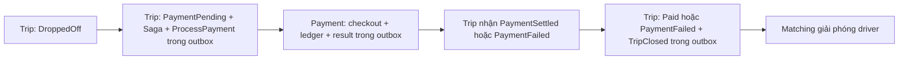
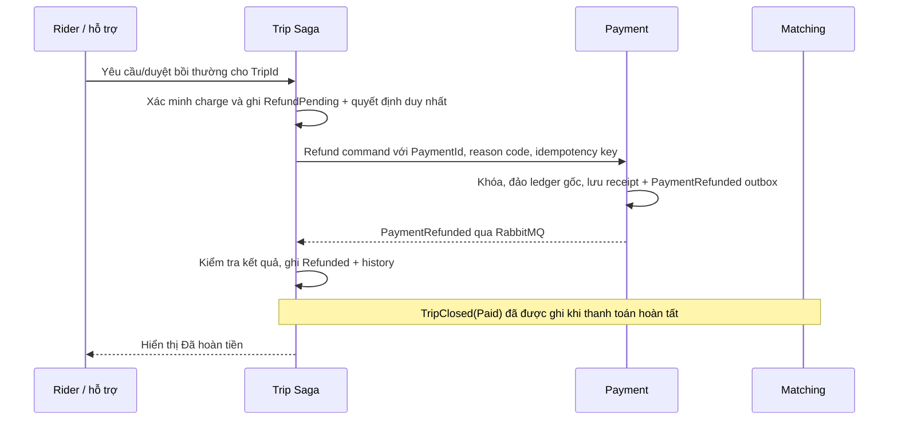

# Contract Saga và bồi thường sau thanh toán

**Phạm vi hiện tại:** sau dropoff, Trip tạo Payment Saga và phát `ProcessPayment` qua outbox. Payment xử lý, Trip nhận kết quả. Consumer `RideCompleted` vẫn tồn tại để nhận tin của những chuyến cũ.

## Trước khi có tài xế: giữ tiền khác với thu tiền

Ở nhiều ứng dụng, khoản tiền hiển thị “đang xử lý” trước chuyến là **authorization hold** (giữ hạn mức), chưa phải charge cuối. Khi chuyến bị hủy, hệ thống hủy/release hold; sau khi hoàn tất mới capture khoản thực thu. Đây là một mô hình khác với việc charge trước rồi refund.

SwiftRide hiện **chưa có authorization hold/reservation**. Rider chọn phương thức ở bước confirm, nhưng Payment chỉ thu tiền khi Trip phát `ProcessPayment` sau dropoff. Vì vậy tài xế hủy **trước dropoff** thì không có khoản charge của chuyến để refund. Nếu sau này chọn mô hình giữ tiền trước khi tìm tài xế, cần contract `Authorize/Release/Capture` riêng; hủy chuyến sẽ `Release`, còn `Refund` chỉ dùng khi đã charge thành công.

## 1. Luồng đang có và điểm có thể thất bại



**Ranh giới Payment Saga:** Trip theo dõi `ProcessPayment` đến khi nhận `PaymentSettled` hoặc `PaymentFailed`. Nếu quá hạn, Saga tra Payment theo `TripId`; timeout không tự biến thành lỗi thanh toán. Chỉ khi đã xác minh Payment `SUCCEEDED` và có quyết định của Admin, Saga phát `RefundPayment` và chờ `PaymentRefunded` hoặc `PaymentRefundFailed`. `TripClosed` và Matching giải phóng tài xế nằm ngoài Saga.

| Điểm lỗi | Trạng thái tiền | Quyết định |
| --- | --- | --- |
| Trip outbox chưa phát `ProcessPayment`, RabbitMQ/Payment tạm ngừng | Chưa biết đã thu hay chưa; kiểm tra Payment theo `TripId` | Retry phát/nhận, giữ Trip `PaymentPending`; không tự refund. |
| Gateway trả `Unknown` | Payment `PENDING`, chưa ghi charge trong ledger nội bộ | Giữ Trip `PaymentPending`, đối soát authorization; không coi là thất bại và không refund khi chưa biết kết quả. |
| Wallet thiếu tiền hoặc Card `Declined` | Payment `FAILED`, không có charge | Trip `PaymentFailed`; không refund vì chưa thu tiền. |
| Payment `SUCCEEDED` nhưng `PaymentSettled` chưa đến Trip | Đã thu tiền, Trip vẫn `PaymentPending` | Retry outbox/consumer và đối soát theo `TripId`; không tự refund vì chuyến đã hoàn tất. |
| Trip nhận `PaymentSettled` nhưng DB tạm lỗi | Đã thu tiền, Trip chưa `Paid` | Retry cùng event; chống xử lý trùng bằng `EventId`. Không refund. |
| Trip từ chối `PaymentSettled` vì dữ liệu không khớp chuyến | Có thể đã thu tiền sai | Dừng tự động, đưa vào hàng đối soát. Chỉ refund sau khi xác minh giao dịch không hợp lệ. |
| Trip đã `Paid` nhưng chưa phát `TripClosed`, hoặc Matching tạm lỗi | Đã thu tiền đúng | Retry `TripClosed`; không refund vì lỗi giải phóng driver không làm chuyến mất hiệu lực. |

**Quy tắc chính:** lỗi mạng, consumer, outbox hoặc Matching **không phải điều kiện refund**. Không lấy việc một message vào `_error` làm bằng chứng phải hoàn tiền. Cần kiểm tra trạng thái Payment và sự kiện gốc trước khi quyết định.

## 2. Khi nào được bồi thường bằng refund?

Chỉ tạo yêu cầu refund khi thỏa **tất cả** điều kiện:

1. Payment của đúng `TripId` là `SUCCEEDED`, có đủ ba dòng `CHARGE` gốc và chưa `REFUNDED`.
2. Có kết luận nghiệp vụ rằng khoản thu **không còn hợp lệ**: chuyến bị xác minh sai sau khi thu tiền, khoản thu sai được đối soát xác nhận, hoặc yêu cầu hoàn được người có quyền duyệt theo quy trình hỗ trợ.
3. `PaymentId`, `TripId`, số tiền, Rider, Driver và phương thức khớp bản ghi gốc. Một Trip không được có hai compensation đang chạy.
4. Có `RefundReasonCode` ổn định và `IdempotencyKey` cố định cho cùng một quyết định bồi thường. Retry phải dùng lại key; không tạo key mới.

**Không refund** khi Payment là `PENDING`/`FAILED`, khi chỉ có lỗi hạ tầng, hoặc khi chưa xác minh được charge. Với Card `Unknown`, tra cứu authorization trước; không tự suy diễn `Unknown = Declined` hay `Unknown = Approved`.

Mã lý do dùng trong Saga (không chứa mô tả tự do):

| `RefundReasonCode` | Điều kiện xác minh | Quyền duyệt |
| --- | --- | --- |
| `INVALID_TRIP_CHARGE` | Chuyến/giá cước không hợp lệ nhưng Payment đã `SUCCEEDED`; có kết luận đối soát gắn `TripId` và `PaymentId` | Nhân sự hỗ trợ được cấp quyền refund |
| `APPROVED_CUSTOMER_REFUND` | Chuyến hợp lệ nhưng yêu cầu hoàn của khách đã được duyệt và ghi lý do trong hồ sơ hỗ trợ | Nhân sự hỗ trợ được cấp quyền refund |

Không thêm mã “lỗi Matching”, “RabbitMQ timeout” hay “consumer vào `_error`”: các tình huống đó cần retry/đối soát kỹ thuật. Mỗi quyết định lưu người duyệt, thời điểm, reason code và tham chiếu bằng chứng ở hồ sơ nội bộ; event chỉ mang reason code.

Refund hiện có ở `RefundAppService` + `PaymentSettlement.Refund`: khóa payment/refund key và các tài khoản, đảo **đúng ledger CHARGE gốc**, lưu `RefundReceipt`; Card ghi thêm refund ở gateway giả lập. Không dùng `DriverRate` hiện tại để tính lại phần chia. Nếu Driver/Platform không đủ số dư để đảo ledger, refund hiện trả `REFUND_INSUFFICIENT_FUNDS`; Saga giữ yêu cầu ở trạng thái chờ xử lý, không báo đã hoàn.

## 3. Trạng thái Trip sau bồi thường

`TripStatus` hiện có các trạng thái bồi thường:

| Trip status | Ý nghĩa | Trạng thái Payment tương ứng | Người dùng thấy |
| --- | --- | --- | --- |
| `PaymentPending` | Chưa có kết quả thanh toán cuối | `PENDING` hoặc chưa thấy Payment | “Chuyến đã kết thúc, đang xử lý thanh toán.” |
| `Paid` | Đã thu tiền, chưa có quyết định refund | `SUCCEEDED` | “Đã thanh toán.” |
| `PaymentFailed` | Thu tiền thất bại, không có charge | `FAILED` | “Thanh toán thất bại; chưa bị trừ tiền.” |
| `RefundPending` | Đã chấp thuận bồi thường, đang hoàn/đối soát | Thường vẫn `SUCCEEDED`; chưa khẳng định đã hoàn | “Đang xử lý hoàn tiền.” |
| `Refunded` | Payment đã `REFUNDED` và Trip đã nhận kết quả | `REFUNDED` | “Đã hoàn tiền.” Hiển thị số tiền và mã tham chiếu. |
| `RefundNeedsAttention` | Payment từ chối refund một cách xác định | Vẫn đã thu tiền | “Hoàn tiền cần hỗ trợ xử lý.” |

Các chuyển trạng thái runtime: `Paid → RefundPending → Refunded` hoặc `Paid → RefundPending → RefundNeedsAttention`. Sau khi hỗ trợ xử lý nguyên nhân từ chối, Admin có thể duyệt lại cùng reason/evidence; Trip phát command mới với **cùng refund key** để thử lại. Nếu Payment còn `PaymentUncertain`, Trip đối soát và đưa về `Paid` trước khi cho phép duyệt refund. Lỗi tạm thời giữ `RefundPending`; không đổi sang `PaymentFailed` sau khi đã thu tiền.

Khi Trip ở `RefundPending`, API đọc chuyến cần trả trạng thái đó cùng thông tin thanh toán đủ để UI hiển thị “đang hoàn”, **không trả `CardToken`**. Chỉ hiển thị “đã hoàn” sau khi Payment commit refund và Trip nhận xác nhận. Các trường hợp chờ lâu cần hiển thị mã tham chiếu `TripId`/`PaymentId` để hỗ trợ tra cứu; không hứa thời gian hoàn tiền khi chưa có SLA được cấu hình.

### Bảng chuyển trạng thái Payment Saga

Quy tắc thuần ở `TripService.Application/Sagas/PaymentSagaTransitions.cs`. Dropoff đã khởi tạo Saga trong runtime. `Completed` nghĩa là Trip đã ghi `Paid` cùng history/outbox, không đợi Matching giải phóng tài xế. `Failed` chỉ dùng khi Payment xác nhận chưa thu được tiền. `NeedsAttention` giữ thông tin khoản thu để hỗ trợ xử lý tiếp; nó không tự biến khoản thu thành thất bại.

| Saga hiện tại | Tín hiệu | Saga tiếp theo | Điều kiện và thao tác cần lưu cùng transaction |
| --- | --- | --- | --- |
| `AwaitingPayment` | `PaymentSettled` | `Completed` | Đối chiếu Trip/Payment/EventId; ghi Trip `Paid`, history, `TripClosed`, checkpoint. |
| `AwaitingPayment` | `PaymentDeclined` | `Failed` | Payment xác nhận `FAILED`; ghi Trip `PaymentFailed`, history, `TripClosed`, checkpoint. |
| `AwaitingPayment` | `PaymentOutcomeUnknown` | `PaymentUncertain` | Timeout hoặc Card `Unknown`; tra Payment theo `TripId`, chưa kết luận thất bại. |
| `PaymentUncertain` | `PaymentStillPending` hoặc `PaymentOutcomeUnknown` | `PaymentUncertain` | Giữ yêu cầu gốc, lên lịch đối soát lại; không tạo payment key mới. |
| `PaymentUncertain` | `PaymentSettled`/`VerifiedPaymentSettled` | `Completed` | Kết quả đến muộn hoặc đối soát xác nhận đã charge; ghi Trip `Paid`. |
| `PaymentUncertain` | `PaymentDeclined`/`VerifiedPaymentDeclined` | `Failed` | Chỉ khi xác nhận không có charge; ghi Trip `PaymentFailed`. |
| `AwaitingPayment`/`PaymentUncertain` | `ManualReviewRequired` | `NeedsAttention` | Sai TripId, PaymentId, amount hoặc không thể đối soát; không refund tự động. |
| `Completed` | `ApprovedRefundForVerifiedCharge` | `Compensating` | Quyết định refund được duyệt, Payment còn `SUCCEEDED`; ghi Trip `RefundPending` và `RefundPayment` outbox. |
| `PaymentUncertain`/`NeedsAttention` | `ApprovedRefundForVerifiedCharge` | `Compensating` | Quy tắc dự phòng của state machine; API hiện yêu cầu đối soát về `Completed`/`Paid` trước khi duyệt refund. |
| `Compensating` | `PaymentRefunded` | `Compensated` | Đối chiếu refund; ghi Trip `Refunded`, history và checkpoint. |
| `Compensating` | `RefundOutcomeUnknown` | `Compensating` | Timeout/lỗi kết nối: tra Payment/refund receipt trước khi retry. |
| `Compensating` | `RefundRejected` hoặc `ManualReviewRequired` | `NeedsAttention` | Kết quả từ chối xác định; giữ thông tin đã thu, không báo khách đã hoàn. |
| `NeedsAttention` | `VerifiedPaymentSettled`/`VerifiedPaymentDeclined` | `Completed`/`Failed` | Người có quyền đối soát và ghi kết luận; đồng bộ Trip với kết quả xác minh. |
| `Completed`/`Failed`/`Compensated` | Timeout cũ | Giữ nguyên | Chỉ bỏ qua sau khi kiểm tra timeout thuộc đúng command gốc. |

Các cặp trạng thái/tín hiệu không có trong bảng bị từ chối. Consumer xử lý duplicate cùng `EventId` và payload bằng checkpoint **trước** khi gọi bảng chuyển trạng thái; `EventId` trùng payload khác là lỗi. `ApprovedRefundForVerifiedCharge` chỉ được phát sau khi application đã xác minh Payment `SUCCEEDED`, đúng Trip/amount và có quyết định được duyệt. Bảng thuần không truy vấn DB hoặc tự phê duyệt refund.

### Persistence của Saga

`PaymentSagaInstance` đã có model và bảng `PaymentSagas` trong SQL Server. Một Saga gắn với đúng một Trip: `TripId` và `CorrelationId` đều có unique index; `RowVersion` chặn hai worker ghi đè trạng thái của nhau. Bảng lưu `ProcessPaymentEventId`, deadline thanh toán, `PaymentId` nếu đã biết, `RefundPaymentEventId`/deadline refund nếu có, trạng thái và thời gian cập nhật.

`PaymentSagaRepository` dùng chung `TripDbContext` với `TripRepository`. Khi bắt đầu Saga ở dropoff, thêm Saga và `ProcessPayment` vào context rồi gọi **một lần** `TripRepository.SaveChangesAsync`; nhánh `PaymentPending` hiện có transaction/khóa gán tài xế. Khi xử lý kết quả hay refund, thay đổi Saga, Trip, history, checkpoint và outbox trên cùng context rồi gọi **một lần** `PaymentSagaRepository.SaveChangesAsync` để commit/rollback toàn bộ. Không gọi hai `SaveChangesAsync` riêng cho hai repository.

Trip outbox phát `ProcessPayment`/`RefundPayment`/`ProcessPaymentTimedOut`. `TripPaymentResultHandler` đối chiếu `CausationId` với Saga command; chỉ tìm `RideCompleted` khi xử lý tin của chuyến cũ chưa có Saga.

## 4. Hợp đồng message Saga

Các record Payment Saga `ProcessPayment`, `ProcessPaymentTimedOut`, `RefundPayment`, `PaymentRefunded`, `PaymentRefundFailed` nằm ở `SwiftRide.Contracts.Events`. Trip phát command, Payment xử lý và Trip nhận kết quả. `PaymentRefunded` đến queue `trip.payment-refunded`:

```csharp
public sealed record PaymentRefunded(
    Guid EventId,
    Guid CorrelationId,   // TripId
    Guid? CausationId,    // Event khởi phát quyết định bồi thường, nếu có
    DateTime OccurredAt,
    Guid TripId,
    Guid PaymentId,
    decimal Amount,
    string ReasonCode,
    int SchemaVersion = EventSchema.V1) : IIntegrationEvent;
```

Payment lưu `PaymentRefunded` vào **Payment outbox trong cùng transaction** với Payment `REFUNDED`, số dư, ledger và `RefundReceipt`; publisher phát sau commit. Trip consumer kiểm tra `TripId`, `PaymentId`, `Amount`, trạng thái `RefundPending` và `EventId`, rồi chuyển `Refunded` cùng history/checkpoint trong một lần lưu. Duplicate cùng `EventId` và payload là no-op; `EventId` trùng nhưng payload khác là lỗi. Không đưa token, số thẻ hoặc lý do tự do vào event/log.

`TripClosed` chấp nhận `Paid`/`PaymentFailed` ở Matching. Quy tắc runtime:

- Nếu Trip đã phát `TripClosed(Paid)`, refund về sau **không phát lại** `TripClosed`; Matching đã giải phóng driver. `PaymentRefunded` chỉ cập nhật Trip/Payment.
- Trip chỉ cho duyệt refund sau khi đã `Paid`, tức `TripClosed(Paid)` đã được ghi vào outbox. Refund không phát thêm `TripClosed`.
- Driver release là tác vụ hậu xử lý có retry, không phải điều kiện để công nhận refund.

`CorrelationId = TripId` xuyên suốt. `CausationId` trỏ đến event gây ra bước kế tiếp khi có event nguồn; `RefundReasonCode` là mã nghiệp vụ, không chứa dữ liệu nhạy cảm. Cần bổ sung mapping log trong BuildingBlocks khi nối luồng runtime và version contract nếu thay đổi các event hiện hữu. Các message Saga là contract mới, không đổi payload của bảy event cũ. `PaymentProtocol.TripPaymentKey(TripId)` giữ key checkout hiện có; `PaymentProtocol.TripRefundKey(TripId)` giữ một key refund cố định cho mỗi chuyến.

## 5. Ai quyết định và ai thực thi?



Trip Saga là nơi **điều phối** bồi thường; Payment là nơi **thực thi** refund và xác nhận kết quả. `POST /trips/{id}/refund-approval` nhận `{ "reasonCode": "APPROVED_CUSTOMER_REFUND", "evidenceReference": "case-123" }` và chỉ cho JWT role `Admin`. Trip kiểm tra Payment `SUCCEEDED` đúng chuyến/số tiền/phương thức, ghi người duyệt, thời điểm, reason code, mã hồ sơ bằng chứng và command trong một transaction. Identity có role `Admin` nhưng không cho đăng ký công khai; tài khoản hỗ trợ cần được cấp riêng. Endpoint `POST /payments/{id}/refund` là API refund trực tiếp hiện có, độc lập với Saga.

## 6. Tiêu chí review trước khi triển khai

- Nhóm review hai `RefundReasonCode`, quyền duyệt và bằng chứng đã chốt ở mục 2 trước khi code Saga.
- Chốt một compensation duy nhất cho mỗi Trip/Payment; retry giữ nguyên key và không nhân đôi ledger/refund.
- Test các trường hợp: Payment đã thu nhưng Trip/Matching tạm lỗi; `Unknown`; mismatch cần đối soát; refund thành công; refund thiếu số dư người nhận; duplicate/out-of-order `PaymentRefunded`; `TripClosed` đến muộn khi driver đã nhận chuyến mới.
- UI/API phân biệt rõ `PaymentPending`, `RefundPending`, `Refunded` và `PaymentFailed`; chỉ báo hoàn tiền khi Payment xác nhận.

## Scheduler timeout thanh toán

`PaymentSagaTimeoutScheduler` quét `PaymentSagas` mỗi `PaymentSaga__TimeoutPollSeconds` (mặc định 5 giây), tối đa `PaymentSaga__TimeoutBatchSize` (mặc định 50) Saga mỗi lượt. Nó chỉ chọn Saga `AwaitingPayment` đã qua `PaymentDeadlineAt` và chưa có `PaymentTimeoutEventId`. SQL Server `UPDLOCK/READPAST` khóa các dòng được chọn để nhiều bản Trip không cùng lập lịch. Trong một transaction, worker lưu `PaymentTimeoutEventId` và event `ProcessPaymentTimedOut` vào Trip outbox. Publisher hiện có gửi event qua RabbitMQ; nếu broker tắt, outbox giữ event và gửi lại khi kết nối phục hồi.

Consumer `trip.process-payment-timed-out` kiểm tra TripId, correlation, command ID, deadline và timeout event ID. Nếu kết quả thanh toán đã đến hoặc timeout cũ, nó bỏ qua. Nếu còn `AwaitingPayment`, Saga chuyển sang `PaymentUncertain`; Trip không bị đổi thành `PaymentFailed` và không tự refund. Trạng thái này cần bước đối soát Payment trước khi chốt thành công, thất bại hoặc bồi thường. Retry tiêu thụ dùng giới hạn trong `SwiftRide.Messaging`; sau khi hết retry MassTransit chuyển tin sang queue `_error`.

Sau timeout, `PaymentSagaReconciler` hỏi `GET /payments/by-trip/{TripId}`. Chỉ `SUCCEEDED`/`FAILED` đã xác minh mới cập nhật Trip và Saga; `PENDING`, chưa thấy Payment hoặc lỗi kết nối giữ `PaymentUncertain`. Refund quá hạn được đánh dấu `RefundTimedOutAt`; worker tra Payment **và** receipt theo key cố định qua `GET /payments/refunds/by-key/{key}` (scope `payments:read`). Chỉ khi status `REFUNDED`, PaymentId và reason code của receipt khớp command đã duyệt thì Trip chốt `Refunded`. Timeout không tự phát `PaymentRefundFailed`.

## Payment thực thi lệnh hoàn

`RefundPaymentConsumer` nhận queue `payment.refund-payment`, kiểm tra correlation, `PaymentId`, số tiền, reason code và key `trip:{TripId}:refund:v1`. Consumer dùng `RefundAppService.RefundInsideTransactionAsync` để giữ nguyên quy tắc đảo ledger gốc và gateway CARD. Trong cùng transaction, Payment lưu refund, `RefundReceipt`, checkpoint `ProcessedMessage` và `PaymentRefunded` trong outbox. Gửi lại cùng `EventId` chỉ đọc checkpoint, không tạo refund thứ hai. `PaymentOutboxPublisher` phát kết quả sau commit.

Payment không tìm thấy, sai Trip/số tiền, refund không hợp lệ hoặc thiếu số dư người nhận được trả bằng `PaymentRefundFailed` với mã ổn định. Khi nghiệp vụ refund ném lỗi xác định, giao dịch thử hoàn rollback trước; checkpoint và event thất bại được lưu trong giao dịch mới. Lỗi hạ tầng/gateway không bị coi là refund thất bại: MassTransit retry có giới hạn và sau đó chuyển `_error` để điều tra. Trip nhận kết quả ở `trip.payment-refunded` hoặc `trip.payment-refund-failed`, đối chiếu command và cập nhật Saga/Trip/history/checkpoint trong một transaction.
