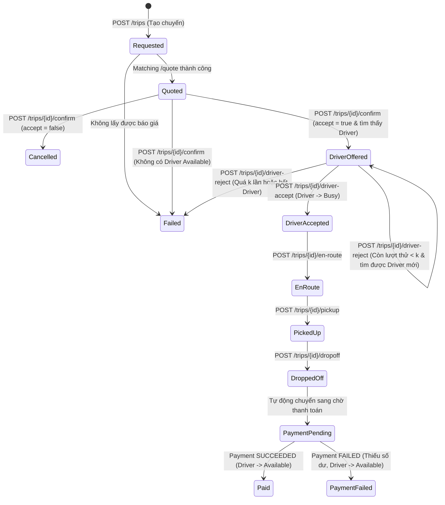

# Tài liệu Tổng hợp API, Luồng Nghiệp vụ (Rider & Driver) và Hướng dẫn Postman 1-Click

> **Cập nhật:** Hướng dẫn kiểm thử Postman theo Payment Saga hiện tại nằm ở [POSTMAN-TEST-CHI-TIET.md](POSTMAN-TEST-CHI-TIET.md). Phần mô tả worker HTTP, `RideCompleted` và chạy Runner 1-click bên dưới là luồng cũ, chỉ dùng để tham khảo lịch sử API.

Tài liệu này tổng hợp toàn bộ danh sách API của dự án **SwiftRide**, luồng hoạt động End-to-End của **Rider** và **Driver**, cùng hướng dẫn thiết lập và chạy kiểm thử tự động 1-Click trên **Postman** cho cả nhóm.

---

## PHẦN 1: Danh sách chi tiết toàn bộ API (Method, Route, Quyền, Request, Response)

### 1.1. Tổng quan định tuyến tại API Gateway (`http://localhost:5000`)

Mọi request từ Frontend hoặc Postman của người dùng cuối đều đi qua **API Gateway (`:5000`)**. Các endpoint nội bộ giữa các service sẽ không được mở route trên Gateway hoặc bị chặn trực tiếp bằng Middleware:

| Method | Route qua Gateway | Đích (Service) | Quyền (Auth / Role) | Mô tả |
|---|---|---|---|---|
| `GET` | `/health` | Gateway tự tổng hợp | Public (Không cần token) | Kiểm tra trạng thái DB của cả 4 microservice (`200 OK` hoặc `503 Service Unavailable`) |
| `*` | `/auth/{**catch-all}` | Identity (`:5004`) | Tùy endpoint | Đăng ký, đăng nhập, lấy thông tin cá nhân |
| `*` | `/availability/{**catch-all}` | Matching (`:5002`) | `Driver` | Bật/tắt trạng thái trực tuyến và cập nhật tọa độ GPS |
| `*` | `/trips/{**catch-all}` | Trip (`:5001`) | `Rider` / `Driver` | Đặt chuyến, xác nhận giá, tài xế nhận/từ chối/đón/trả khách |
| `*` | `/drivers/me/{**catch-all}` | Trip (`:5001`) | `Driver` | Xem danh sách lời mời (`offers`) và chuyến hiện tại của tài xế |
| `GET` | `/payments/{id}` | Payment (`:5003`) | `Rider` (chủ giao dịch) | Xem chi tiết thanh toán theo `paymentId` |
| `GET` | `/payments/by-trip/{tripId}` | Payment (`:5003`) | `Rider` / `Driver` của chuyến | Xem chi tiết thanh toán theo `tripId` |
| `GET` | `/wallets/me` | Payment (`:5003`) | `Rider` / `Driver` | Xem số dư ví và lịch sử biến động số dư (Ledger) |
| `POST` | `/payments`, `/payments/{id}/refund` | **Bị chặn tại Gateway** | — | Trả về `403 Forbidden` (`INTERNAL_ENDPOINT_ONLY`) |

---

### 1.2. Identity Service (`http://localhost:5004`) — Quản lý định danh & JWT

#### Tài khoản mẫu có sẵn (Seed Data — Mật khẩu chung: `123456`)
| Vai trò | Họ tên | Số điện thoại | User ID (`sub`) | Ghi chú |
|---|---|---|---|---|
| **Rider 01** | Nguyễn Văn An | `0900000001` | `11111111-0000-0000-0000-000000000001` | Số dư ví: **500.000đ** (Dùng test luồng thanh toán thành công) |
| **Rider 02** | Trần Thị Bình | `0900000002` | `11111111-0000-0000-0000-000000000002` | Số dư ví: **20.000đ** (Dùng test luồng thiếu tiền `PaymentFailed`) |
| **Driver 01** | Lê Văn Cường | `0910000001` | `22222222-0000-0000-0000-000000000001` | Vị trí mẫu: Chợ Bến Thành (`10.7725, 106.6980`) |
| **Driver 02** | Phạm Minh Dũng | `0910000002` | `22222222-0000-0000-0000-000000000002` | Vị trí mẫu: Nhà thờ Đức Bà (`10.7798, 106.6990`) |
| **Driver 03** | Hoàng Văn Em | `0910000003` | `22222222-0000-0000-0000-000000000003` | Vị trí mẫu: Bitexco (`10.7716, 106.7044`) |
| **Driver 04** | Võ Thị Phương | `0910000004` | `22222222-0000-0000-0000-000000000004` | Vị trí mẫu: Dinh Độc Lập (`10.7770, 106.6953`) |
| **Driver 05** | Đặng Quốc Gia | `0910000005` | `22222222-0000-0000-0000-000000000005` | Vị trí mẫu: ĐH Sài Gòn (`10.7598, 106.6823`) |

---

#### 1) `POST /auth/register` — Đăng ký tài khoản mới
- **URL qua Gateway:** `POST {{gatewayUrl}}/auth/register`
- **Quyền:** Public (Không cần token)
- **Request Body:**
  ```json
  {
    "fullName": "Nguyễn Văn Mới",
    "phone": "0988888888",
    "password": "123456",
    "role": "Rider"
  }
  ```
  *(Lưu ý: `role` chỉ nhận `"Rider"` hoặc `"Driver"`, `phone` phải gồm 10 chữ số bắt đầu bằng `0`, `password` tối thiểu 6 ký tự).*
- **Response (`201 Created`):**
  ```json
  {
    "id": "3fa85f64-5717-4562-b3fc-2c963f66afa6",
    "fullName": "Nguyễn Văn Mới",
    "phone": "0988888888",
    "role": "Rider"
  }
  ```
- **Cơ chế đồng bộ ngầm (Outbox Pattern):**
  - Ghi sự kiện `UserRegistered` vào bảng `OutboxMessages` -> `WalletRegistrationWorker` gọi sang Payment Service (`PUT /internal/accounts/users/{userId}`) để khởi tạo ví với số dư `0đ`.
  - Nếu `role = "Driver"`, ghi thêm sự kiện `DriverRegistered` -> `DriverRegistrationWorker` gọi sang Matching Service (`PUT /internal/drivers/{driverId}`) để đăng ký tài xế.
- **Mã lỗi:** `400 VALIDATION_ERROR`, `409 PHONE_ALREADY_EXISTS`.

#### 2) `POST /auth/login` — Đăng nhập lấy JWT
- **URL qua Gateway:** `POST {{gatewayUrl}}/auth/login`
- **Quyền:** Public
- **Request Body:**
  ```json
  {
    "phone": "0900000001",
    "password": "123456"
  }
  ```
- **Response (`200 OK`):**
  ```json
  {
    "accessToken": "eyJhbGciOiJIUzI1NiIs...",
    "expiresIn": 7200,
    "user": {
      "id": "11111111-0000-0000-0000-000000000001",
      "fullName": "Nguyễn Văn An",
      "phone": "0900000001",
      "role": "Rider"
    }
  }
  ```
- **Mã lỗi:** `401 INVALID_CREDENTIALS`, `403 ACCOUNT_LOCKED`.

#### 3) `GET /auth/me` — Xem thông tin người dùng hiện tại
- **URL qua Gateway:** `GET {{gatewayUrl}}/auth/me`
- **Quyền:** `[Authorize]` (Header `Authorization: Bearer <accessToken>`)
- **Request Body:** Không có
- **Response (`200 OK`):**
  ```json
  {
    "id": "11111111-0000-0000-0000-000000000001",
    "fullName": "Nguyễn Văn An",
    "phone": "0900000001",
    "role": "Rider"
  }
  ```
- **Mã lỗi:** `401 UNAUTHORIZED`, `404 USER_NOT_FOUND`.

---

### 1.3. Matching & Pricing Service (`http://localhost:5002`) — Định vị, Ghép xe & Tính giá

#### A. API Public (Đi qua Gateway `/availability/*`)

##### 1) `POST /availability/online` — Tài xế bật nhận chuyến & Cập nhật tọa độ GPS
- **URL qua Gateway:** `POST {{gatewayUrl}}/availability/online`
- **Quyền:** `[Authorize(Roles = "Driver")]`
- **Request Body:**
  ```json
  {
    "lat": 10.7725,
    "lng": 106.6980
  }
  ```
- **Response (`200 OK`):**
  ```json
  {
    "id": "22222222-0000-0000-0000-000000000001",
    "name": "Lê Văn Cường",
    "status": "Available",
    "location": {
      "lat": 10.7725,
      "lng": 106.6980
    },
    "updatedAt": "2026-11-16T05:00:00Z"
  }
  ```
- **Mã lỗi:** `400 VALIDATION_ERROR` (thiếu hoặc sai tọa độ `-90 <= lat <= 90`, `-180 <= lng <= 180`), `409 DRIVER_BUSY` (đang chở khách không được bật lại).

##### 2) `POST /availability/offline` — Tài xế tắt nhận chuyến
- **URL qua Gateway:** `POST {{gatewayUrl}}/availability/offline`
- **Quyền:** `[Authorize(Roles = "Driver")]`
- **Request Body:** Không có
- **Response (`200 OK`):** Trả về `DriverDto` với `"status": "Offline"`.
- **Mã lỗi:** `404 DRIVER_NOT_FOUND`, `409 DRIVER_BUSY`.

##### 3) `GET /availability/me` — Xem trạng thái trực tuyến hiện tại của tài xế
- **URL qua Gateway:** `GET {{gatewayUrl}}/availability/me`
- **Quyền:** `[Authorize(Roles = "Driver")]`
- **Response (`200 OK`):** Trả về `DriverDto` hiện tại của tài xế.
- **Mã lỗi:** `404 DRIVER_NOT_FOUND` (nếu tài xế chưa từng bật nhận chuyến).

#### B. API Nội bộ (Service-to-Service, KHÔNG mở trên Gateway)

| Method & Route (`:5002`) | Người gọi | Quyền / Policy | Request Body | Response |
|---|---|---|---|---|
| `POST /quote` | Trip Service | `[Authorize]` | `{ "tripId": "guid", "pickup": { "lat": 10.7725, "lng": 106.698 }, "dropoff": { "lat": 10.7798, "lng": 106.699 } }` | `200 OK`: `{ "quoteId": "...", "distanceKm": 0.82, "durationMin": 2.46, "strategy": "Standard", "price": 25000 }` |
| `POST /match` | Trip Service | `[Authorize]` | `{ "pickupLat": 10.7725, "pickupLng": 106.698, "radiusKm": 5, "excludeDriverIds": ["..."] }` | `200 OK`: `{ "driverId": "...", "name": "...", "status": "Available", "distanceKm": 0.0, "location": { "lat": ..., "lng": ... } }` |
| `PUT /drivers/{id}/status` | Trip Service | `sub = trip-service`, `scope = drivers:status` | `{ "status": "Busy", "tripId": "guid" }` | `200 OK`: `DriverDto` |
| `PUT /internal/drivers/{driverId}` | Identity Worker | `sub = identity-service`, `scope = drivers:register` | `{ "driverId": "guid", "fullName": "...", "phone": "..." }` | `204 No Content` |

---

### 1.4. Trip Service (`http://localhost:5001`) — Điều phối vòng đời chuyến đi (State Machine)

#### A. Nhóm API cho Rider (`/trips/*`)

##### 1) `POST /trips` — Đặt xe & Nhận báo giá
- **URL qua Gateway:** `POST {{gatewayUrl}}/trips`
- **Quyền:** `[Authorize(Roles = "Rider")]`
- **Request Body:**
  ```json
  {
    "pickup": {
      "lat": 10.7725,
      "lng": 106.6980,
      "address": "Chợ Bến Thành"
    },
    "dropoff": {
      "lat": 10.7798,
      "lng": 106.6990,
      "address": "Nhà thờ Đức Bà"
    }
  }
  ```
- **Response (`201 Created`):**
  ```json
  {
    "tripId": "8f14d508-3a1b-4c2d-9e0f-123456789abc",
    "status": "Quoted",
    "price": 25000,
    "distanceKm": 0.82,
    "durationMin": 2.46,
    "strategy": "Standard"
  }
  ```
- **Mã lỗi:** `400 VALIDATION_ERROR`, `409 ACTIVE_TRIP_EXISTS` (Rider đang có chuyến chưa kết thúc), `502/504` (Matching Service lỗi).

##### 2) `GET /trips/me/current` — Lấy chuyến đi chưa kết thúc của Rider
- **URL qua Gateway:** `GET {{gatewayUrl}}/trips/me/current`
- **Quyền:** `[Authorize(Roles = "Rider")]`
- **Response:** `200 OK` (`TripDetailDto`) hoặc `204 No Content` (nếu hiện không có chuyến đang chạy).

##### 3) `POST /trips/{id:guid}/confirm` — Xác nhận hoặc từ chối báo giá
- **URL qua Gateway:** `POST {{gatewayUrl}}/trips/{{tripId}}/confirm`
- **Quyền:** `[Authorize(Roles = "Rider")]` (Phải là chủ chuyến đi và chuyến đang ở trạng thái `Quoted`)
- **Request Body (Đồng ý báo giá):**
  ```json
  {
    "accept": true,
    "paymentMethod": "WALLET"
  }
  ```
  *(Hoặc từ chối báo giá: `{ "accept": false }`)*
- **Response (`200 OK`):**
  - Đồng ý & tìm được tài xế:
    ```json
    {
      "status": "DriverOffered",
      "message": "Đã gửi lời mời đến tài xế gần nhất."
    }
    ```
  - Từ chối giá:
    ```json
    {
      "status": "Cancelled",
      "message": "Rider đã từ chối giá cước."
    }
    ```
- **Mã lỗi:** `400 VALIDATION_ERROR`, `403 FORBIDDEN`, `404 TRIP_NOT_FOUND` (hoặc không có tài xế), `409 INVALID_TRIP_STATE`.

##### 4) `GET /trips/{id:guid}` — Xem chi tiết chuyến đi & lịch sử chuyển trạng thái
- **URL qua Gateway:** `GET {{gatewayUrl}}/trips/{{tripId}}`
- **Quyền:** `[Authorize]` — Chỉ **Rider sở hữu chuyến** hoặc **Driver được mời (`Pending`) / đã nhận chuyến (`Accepted`)** mới xem được.
- **Response (`200 OK` - `TripDetailDto`):**
  ```json
  {
    "id": "8f14d508-3a1b-4c2d-9e0f-123456789abc",
    "status": "Paid",
    "pickup": { "lat": 10.7725, "lng": 106.698, "address": "Chợ Bến Thành" },
    "dropoff": { "lat": 10.7798, "lng": 106.699, "address": "Nhà thờ Đức Bà" },
    "fare": {
      "price": 25000,
      "paymentMethod": "WALLET",
      "distanceKm": 0.82,
      "durationMin": 2.46,
      "strategy": "Standard",
      "status": "Accepted"
    },
    "driver": {
      "id": "22222222-0000-0000-0000-000000000001",
      "name": "Lê Văn Cường"
    },
    "history": [
      { "from": null, "to": "Requested", "at": "..." },
      { "from": "Requested", "to": "Quoted", "at": "..." },
      { "from": "Quoted", "to": "DriverOffered", "at": "..." },
      { "from": "DriverOffered", "to": "DriverAccepted", "at": "..." },
      { "from": "DriverAccepted", "to": "EnRoute", "at": "..." },
      { "from": "EnRoute", "to": "PickedUp", "at": "..." },
      { "from": "PickedUp", "to": "DroppedOff", "at": "..." },
      { "from": "DroppedOff", "to": "PaymentPending", "at": "..." },
      { "from": "PaymentPending", "to": "Paid", "at": "..." }
    ]
  }
  ```

#### B. Nhóm API cho Driver (`/drivers/me/*` và `/trips/{id}/*`)

##### 5) `GET /drivers/me/offers` — Xem danh sách lời mời chuyến đang chờ (`Pending`)
- **URL qua Gateway:** `GET {{gatewayUrl}}/drivers/me/offers`
- **Quyền:** `[Authorize(Roles = "Driver")]`
- **Response (`200 OK`):**
  ```json
  [
    {
      "offerId": "b192c3d4-...",
      "tripId": "8f14d508-3a1b-4c2d-9e0f-123456789abc",
      "pickup": { "lat": 10.7725, "lng": 106.698, "address": "Chợ Bến Thành" },
      "dropoff": { "lat": 10.7798, "lng": 106.699, "address": "Nhà thờ Đức Bà" },
      "price": 25000,
      "distanceToPickupKm": 0.0,
      "createdAt": "2026-11-16T05:01:00Z"
    }
  ]
  ```

##### 6) `GET /drivers/me/current-trip` — Xem chuyến tài xế đang thực hiện
- **URL qua Gateway:** `GET {{gatewayUrl}}/drivers/me/current-trip`
- **Quyền:** `[Authorize(Roles = "Driver")]`
- **Response:** `200 OK` (`TripDetailDto`) hoặc `204 No Content`.

##### 7) `POST /trips/{id:guid}/driver-accept` (hoặc `POST /drivers/me/offers/{tripId:guid}/accept`) — Tài xế nhận chuyến
- **URL qua Gateway:** `POST {{gatewayUrl}}/trips/{{tripId}}/driver-accept`
- **Quyền:** `[Authorize(Roles = "Driver")]` (Phải đúng tài xế có offer `Pending`)
- **Request Body:** Không có
- **Response (`200 OK`):**
  ```json
  { "status": "DriverAccepted" }
  ```
  *(Đồng thời Trip Service gọi sang Matching Service đổi trạng thái tài xế sang `Busy`).*

##### 8) `POST /trips/{id:guid}/driver-reject` (hoặc `POST /drivers/me/offers/{tripId:guid}/reject`) — Tài xế từ chối lời mời
- **URL qua Gateway:** `POST {{gatewayUrl}}/trips/{{tripId}}/driver-reject`
- **Quyền:** `[Authorize(Roles = "Driver")]`
- **Request Body:** Không có
- **Response (`200 OK`):**
  - Nếu còn lượt ghép (`MaxOfferAttempts = 2`) và tìm được tài xế tiếp theo: `{ "status": "DriverOffered" }`
  - Nếu hết lượt hoặc không còn tài xế: `{ "status": "Failed" }`

##### 9) `POST /trips/{id:guid}/en-route` — Tài xế bắt đầu di chuyển đến điểm đón
- **URL qua Gateway:** `POST {{gatewayUrl}}/trips/{{tripId}}/en-route`
- **Quyền:** `[Authorize(Roles = "Driver")]` (Tài xế đã `Accepted` chuyến)
- **Response (`200 OK`):** `{ "status": "EnRoute" }`

##### 10) `POST /trips/{id:guid}/pickup` — Tài xế đã đón khách lên xe
- **URL qua Gateway:** `POST {{gatewayUrl}}/trips/{{tripId}}/pickup`
- **Quyền:** `[Authorize(Roles = "Driver")]`
- **Response (`200 OK`):** `{ "status": "PickedUp" }`

##### 11) `POST /trips/{id:guid}/dropoff` — Tài xế trả khách & Tự động thanh toán
- **URL qua Gateway:** `POST {{gatewayUrl}}/trips/{{tripId}}/dropoff`
- **Quyền:** `[Authorize(Roles = "Driver")]`
- **Response (`200 OK`):**
  ```json
  { "status": "Paid" }
  ```
  *(Nếu ví Rider không đủ tiền sẽ trả `{ "status": "PaymentFailed" }`, đồng thời giải phóng tài xế về `Available`).*

---

### 1.5. Payment Service (`http://localhost:5003`) — Ví điện tử, Sổ cái (Double-Entry Ledger) & Hoàn tiền

#### A. API Public (Đi qua Gateway)

##### 1) `GET /wallets/me` — Xem số dư ví và lịch sử sổ cái (Ledger)
- **URL qua Gateway:** `GET {{gatewayUrl}}/wallets/me`
- **Quyền:** `[Authorize]` (`Rider` hoặc `Driver`)
- **Response (`200 OK`):**
  ```json
  {
    "balance": 475000.00,
    "entries": [
      {
        "paymentId": "9a12b3c4-...",
        "entryType": "CHARGE",
        "amount": -25000.00,
        "createdAt": "2026-11-16T05:05:00Z"
      }
    ]
  }
  ```
- **Mã lỗi:** `404 ACCOUNT_NOT_FOUND` (nếu ví chưa được đồng bộ).

##### 2) `GET /payments/by-trip/{tripId:guid}` — Xem chi tiết thanh toán theo chuyến đi
- **URL qua Gateway:** `GET {{gatewayUrl}}/payments/by-trip/{{tripId}}`
- **Quyền:** `Rider` (chủ chuyến) hoặc `Driver` (tài xế nhận chuyến) hoặc Service nội bộ có `scope = payments:read`.
- **Response (`200 OK`):**
  ```json
  {
    "id": "9a12b3c4-...",
    "tripId": "8f14d508-3a1b-4c2d-9e0f-123456789abc",
    "amount": 25000.00,
    "method": "WALLET",
    "status": "SUCCEEDED",
    "attemptCount": 1,
    "failureReason": null,
    "driverAmount": 20000.00,
    "platformAmount": 5000.00
  }
  ```
- **Mã lỗi:** `403 FORBIDDEN`, `404 PAYMENT_NOT_FOUND`.

##### 3) `GET /payments/{id:guid}` — Xem chi tiết thanh toán theo Payment ID
- **URL qua Gateway:** `GET {{gatewayUrl}}/payments/{{paymentId}}`
- **Quyền:** Chỉ `Rider` sở hữu giao dịch (`PaymentSecurity.RiderPolicy`).
- **Response (`200 OK`):** `PaymentDetailResponse` như trên.

#### B. API Nội bộ (Bị chặn tại API Gateway với `403 INTERNAL_ENDPOINT_ONLY`)

| Method & Route (`:5003`) | Người gọi | Quyền / Policy | Request Body & Header | Response |
|---|---|---|---|---|
| `POST /payments` | Trip Service | `sub = trip-service`, `scope = payments:create` | `{ "tripId": "...", "riderId": "...", "driverId": "...", "amount": 25000, "method": "WALLET", "idempotencyKey": "trip:{tripId}:payment:v1" }` | `201 Created` (mới) / `200 OK` (replay): `{ "paymentId": "...", "status": "SUCCEEDED" \| "FAILED" }` |
| `POST /payments/{id}/refund` | Quản trị / Nội bộ | `sub = trip-service`, `scope = payments:refund` | Header `Idempotency-Key: <key>`, Body `{ "reason": "Customer request" }` | `200 OK`: `{ "status": "REFUNDED" }` |
| `PUT /internal/accounts/users/{userId}` | Identity Worker | `sub = identity-service`, `scope = wallets:register` | `{ "userId": "guid", "role": "Rider" \| "Driver" }` | `204 No Content` |

---

## PHẦN 2: Sơ đồ & Luồng nghiệp vụ của Rider và Driver

### 2.1. Sơ đồ chuyển trạng thái chuyến đi (Trip State Machine)



### 2.2. Luồng tương tác tuần tự End-to-End (Rider & Driver)

1. **Bước 1 (Chuẩn bị):**
   - **Rider** đăng nhập (`POST /auth/login`) -> Lấy `riderToken`.
   - **Driver** đăng nhập (`POST /auth/login`) -> Lấy `driverToken`.
   - **Driver** bật nhận chuyến tại khu vực Quận 1 (`POST /availability/online` với tọa độ `10.7725, 106.6980`).
2. **Bước 2 (Đặt xe & Báo giá):**
   - **Rider** gửi điểm đón và điểm đến (`POST /trips`).
   - **Trip Service** gọi sang **Matching Service** (`POST /quote`) tính khoảng cách Haversine, thời gian dự kiến và giá cước -> Lưu `Trip` ở trạng thái `Quoted` và trả `tripId` về cho Rider.
3. **Bước 3 (Xác nhận giá & Ghép tài xế):**
   - **Rider** đồng ý giá cước với phương thức ví điện tử (`POST /trips/{tripId}/confirm` với `{"accept": true, "paymentMethod": "WALLET"}`).
   - **Trip Service** gọi sang **Matching Service** (`POST /match`) truy vấn không gian địa lý (`$nearSphere` MongoDB) tìm tài xế `Available` gần điểm đón nhất -> Tạo bản ghi `TripDriverOffer` (`Pending`) và chuyển chuyến sang `DriverOffered`.
4. **Bước 4 (Tài xế nhận chuyến & Thực hiện hành trình):**
   - **Driver** kiểm tra lời mời (`GET /drivers/me/offers`) -> Thấy chuyến đi vừa được mời.
   - **Driver** bấm nhận chuyến (`POST /trips/{tripId}/driver-accept`) -> Chuyến chuyển sang `DriverAccepted`, **Matching Service** cập nhật tài xế sang `Busy`.
   - **Driver** cập nhật tiến trình lần lượt:
     - Đang đến đón: `POST /trips/{tripId}/en-route` (`EnRoute`)
     - Đã đón khách: `POST /trips/{tripId}/pickup` (`PickedUp`)
     - Đã trả khách: `POST /trips/{tripId}/dropoff` (`DroppedOff` -> `PaymentPending`).
5. **Bước 5 (Thanh toán Sổ cái Kép & Hoàn tất):**
   - Khi `dropoff`, **Trip Service** tự động gọi **Payment Service** (`POST /payments` kèm `Idempotency-Key: trip:{tripId}:payment:v1`).
   - **Payment Service** khóa tài khoản trong Transaction PostgreSQL, kiểm tra số dư ví của Rider, và ghi **3 bút toán sổ cái (Double-Entry Ledger)**:
     - Ví Rider: `-100%` giá cuốc xe (`CHARGE`)
     - Ví Driver: `+80%` giá cuốc xe (`CHARGE`)
     - Ví Platform: `+20%` phí nền tảng (`CHARGE`)
   - Chuyến đi chuyển sang `Paid`, tài xế được giải phóng về `Available`.
   - Cả **Rider** và **Driver** gọi `GET /payments/by-trip/{tripId}` và `GET /wallets/me` để đối chiếu số dư và lịch sử giao dịch.

---

## PHẦN 3: Thiết lập & Chạy Postman 1-Click cho Nhóm

Hai file cấu hình Postman chuẩn đã được xuất sẵn trong cùng thư mục `postman/` này:
1. **Collection:** `SwiftRide-EndToEnd.postman_collection.json`
2. **Environment:** `SwiftRide-Gateway.postman_environment.json`

### 3.1. Cấu trúc Collection theo đúng luồng nghiệp vụ (End-to-End Flow)
Bộ Collection được chia thành **6 thư mục** đánh số thứ tự từ `00` đến `05` để chạy tuần tự từ trên xuống dưới:

- **`00. System Health Check`**
  - `0.1 Check Gateway & All Microservices Health` (`GET {{gatewayUrl}}/health`)
- **`01. Auth & Onboarding (Identity Service)`**
  - `1.1 Login Rider (Nguyễn Văn An - Ví 500k)` (`POST {{gatewayUrl}}/auth/login`)
  - `1.2 Get Rider Profile (/auth/me)` (`GET {{gatewayUrl}}/auth/me`)
  - `1.3 Login Driver (Lê Văn Cường - Chợ Bến Thành)` (`POST {{gatewayUrl}}/auth/login`)
  - `1.4 Get Driver Profile (/auth/me)` (`GET {{gatewayUrl}}/auth/me`)
- **`02. Driver Availability (Matching Service)`**
  - `2.1 Driver Set Online & Update GPS Location` (`POST {{gatewayUrl}}/availability/online`)
  - `2.2 Driver Get My Availability` (`GET {{gatewayUrl}}/availability/me`)
- **`03. Rider Booking & Quote Confirmation (Trip Service)`**
  - `3.1 Rider Check Wallet Before Trip (/wallets/me)` (`GET {{gatewayUrl}}/wallets/me`)
  - `3.2 Rider Create Trip & Get Fare Quote (POST /trips)` (`POST {{gatewayUrl}}/trips`)
  - `3.3 Rider Get Current Active Trip (/trips/me/current)` (`GET {{gatewayUrl}}/trips/me/current`)
  - `3.4 Rider Confirm Fare Quote & Match Nearest Driver` (`POST {{gatewayUrl}}/trips/{{tripId}}/confirm`)
- **`04. Driver Trip Execution (Offer -> EnRoute -> Pickup -> Dropoff)`**
  - `4.1 Driver Poll Pending Offers (/drivers/me/offers)` (`GET {{gatewayUrl}}/drivers/me/offers`)
  - `4.2 Driver Accept Offer (/trips/{id}/driver-accept)` (`POST {{gatewayUrl}}/trips/{{tripId}}/driver-accept`)
  - `4.3 Driver Get Current Trip (/drivers/me/current-trip)` (`GET {{gatewayUrl}}/drivers/me/current-trip`)
  - `4.4 Driver Mark EnRoute (/trips/{id}/en-route)` (`POST {{gatewayUrl}}/trips/{{tripId}}/en-route`)
  - `4.5 Driver Mark PickedUp (/trips/{id}/pickup)` (`POST {{gatewayUrl}}/trips/{{tripId}}/pickup`)
  - `4.6 Driver Mark DroppedOff & Trigger Auto-Payment (/trips/{id}/dropoff)` (`POST {{gatewayUrl}}/trips/{{tripId}}/dropoff`)
- **`05. Post-Trip Verification, Payment & Wallet (Payment & Trip Services)`**
  - `5.1 Rider View Completed Trip & Full History (/trips/{id})` (`GET {{gatewayUrl}}/trips/{{tripId}}`)
  - `5.2 Rider Get Payment Details By Trip (/payments/by-trip/{tripId})` (`GET {{gatewayUrl}}/payments/by-trip/{{tripId}}`)
  - `5.3 Rider Get Payment Details By PaymentId (/payments/{id})` (`GET {{gatewayUrl}}/payments/{{paymentId}}`)
  - `5.4 Rider Check Wallet Balance & Ledger After Trip (/wallets/me)` (`GET {{gatewayUrl}}/wallets/me`)
  - `5.5 Driver Check Wallet Balance & 80% Split Ledger (/wallets/me)` (`GET {{gatewayUrl}}/wallets/me`)
  - `5.6 Security Check: Gateway Blocks Direct POST /payments (403 Forbidden)` (`POST {{gatewayUrl}}/payments`)

---

### 3.2. Danh sách Biến môi trường (Environment Variables)
File `SwiftRide-Gateway.postman_environment.json` đã cấu hình sẵn các biến sau:

| Tên biến | Giá trị khởi tạo | Vai trò |
|---|---|---|
| `gatewayUrl` | `http://localhost:5000` | Địa chỉ API Gateway duy nhất cho toàn bộ request |
| `riderPhone` | `0900000001` | SĐT của Rider01 (Nguyễn Văn An — Ví 500.000đ) |
| `riderLowBalancePhone` | `0900000002` | SĐT của Rider02 (Trần Thị Bình — Ví 20.000đ) |
| `driverPhone` | `0910000001` | SĐT của Driver01 (Lê Văn Cường) |
| `defaultPassword` | `123456` | Mật khẩu mặc định của các tài khoản Seed |
| `riderToken` | *(Tự động gán khi chạy 1.1)* | Bearer JWT của Rider |
| `driverToken` | *(Tự động gán khi chạy 1.3)* | Bearer JWT của Driver |
| `tripId` | *(Tự động gán khi chạy 3.2)* | ID chuyến đi vừa tạo |
| `offerId` | *(Tự động gán khi chạy 4.1)* | ID lời mời chuyến đi của tài xế |
| `paymentId` | *(Tự động gán khi chạy 5.2)* | ID giao dịch thanh toán của chuyến |
| `pickupLat` / `pickupLng` | `10.7725` / `106.6980` | Tọa độ điểm đón (Chợ Bến Thành) |
| `dropoffLat` / `dropoffLng` | `10.7798` / `106.6990` | Tọa độ điểm đến (Nhà thờ Đức Bà) |

---

### 3.3. Chi tiết các Script tự động truyền dữ liệu giữa các bước

Các đoạn script dưới đây đã được nhúng sẵn vào tab **Scripts -> Post-response (Tests)** trong file Collection:

#### 1) Script tự động lưu Token khi Đăng nhập Rider (`Bước 1.1`) & Driver (`Bước 1.3`)
```javascript
pm.test('Đăng nhập thành công (200 OK)', function () {
    pm.response.to.have.status(200);
});

const res = pm.response.json();
if (res && res.accessToken) {
    // Bước 1.1 lưu vào 'riderToken', Bước 1.3 lưu vào 'driverToken'
    pm.environment.set('riderToken', res.accessToken);
    pm.environment.set('riderId', res.user.id);
    console.log('Đã lưu token và userId:', res.user.id);
}
```

#### 2) Script tự động lấy `tripId` khi Rider tạo chuyến (`Bước 3.2 - POST /trips`)
```javascript
pm.test('Tạo chuyến đi và nhận báo giá thành công (201 Created)', function () {
    pm.response.to.have.status(201);
});

const res = pm.response.json();
if (res && res.tripId) {
    pm.environment.set('tripId', res.tripId);
    console.log('Đã lưu tripId:', res.tripId, 'Giá cước:', res.price);
}

pm.test('Trạng thái chuyến đi là Quoted và có giá cước > 0', function () {
    pm.expect(res.status).to.eql('Quoted');
    pm.expect(res.price).to.be.above(0);
});
```

#### 3) Script tự động bắt `offerId` và đối khớp `tripId` cho Tài xế (`Bước 4.1 - GET /drivers/me/offers`)
```javascript
pm.test('Lấy danh sách lời mời của tài xế thành công (200 OK)', function () {
    pm.response.to.have.status(200);
});

const offers = pm.response.json();
if (Array.isArray(offers) && offers.length > 0) {
    const targetTripId = pm.environment.get('tripId');
    const matchedOffer = offers.find(o => o.tripId === targetTripId) || offers[0];
    pm.environment.set('offerId', matchedOffer.offerId);
    pm.environment.set('tripId', matchedOffer.tripId);
    console.log('Đã nhận lời mời offerId:', matchedOffer.offerId, 'cho tripId:', matchedOffer.tripId);
}
```

#### 4) Script tự động lấy `paymentId` sau khi hoàn thành chuyến (`Bước 5.2 - GET /payments/by-trip/{{tripId}}`)
```javascript
pm.test('Tra cứu giao dịch thanh toán theo TripId', function () {
    pm.expect([200, 404]).to.include(pm.response.code);
    if (pm.response.code === 200) {
        const res = pm.response.json();
        pm.environment.set('paymentId', res.id);
        console.log('Đã lưu paymentId:', res.id, 'Status:', res.status, 'Driver nhận:', res.driverAmount);
    }
});
```

---

### 3.4. Hướng dẫn chạy 1-Click với Postman Collection Runner

1. **Khởi động hệ thống:**
   - Bật Docker: `docker compose up -d`
   - Chạy cả 4 Microservices và API Gateway bằng script `.\3-run-services.ps1` (hoặc chạy từng terminal).
2. **Import vào Postman:**
   - Mở **Postman** -> Nhấn nút **Import** (góc trên bên trái).
   - Chọn cả 2 file trong thư mục `postman/`:
     - `SwiftRide-EndToEnd.postman_collection.json`
     - `SwiftRide-Gateway.postman_environment.json`
3. **Kích hoạt Environment:**
   - Nhìn góc trên bên phải của Postman, mở menu thả xuống **Environments** và chọn **`SwiftRide - API Gateway (Local)`**.
4. **Chạy 1-Click (Collection Runner):**
   - Nhấn chuột phải vào Collection **`SwiftRide - End-to-End Business Flow (1-Click Runner)`** -> Chọn **Run collection**.
   - Nhấn nút **Run SwiftRide - End-to-End Business Flow (1-Click Runner)**.
   - Postman sẽ tự động chạy liền mạch toàn bộ 19 request từ đầu đến cuối, tự động truyền Token, `tripId`, `offerId`, `paymentId` và kiểm tra kết quả (Pass/Fail) cho từng bước.
